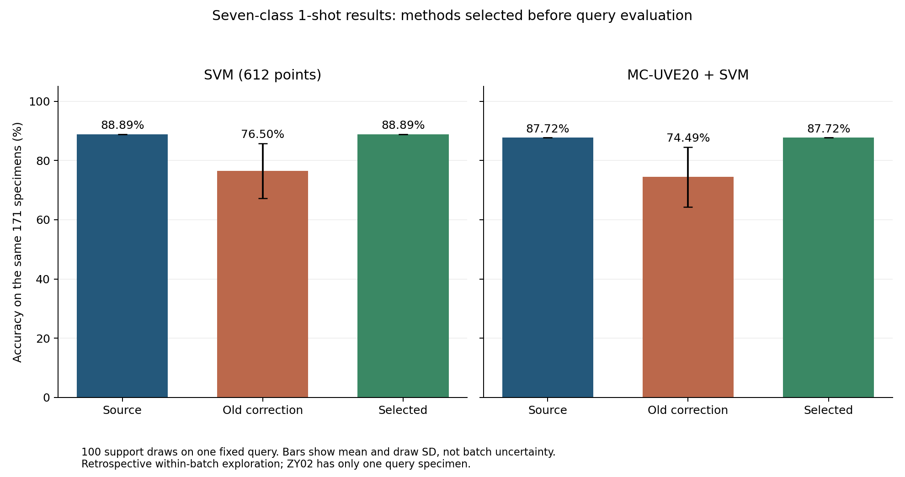
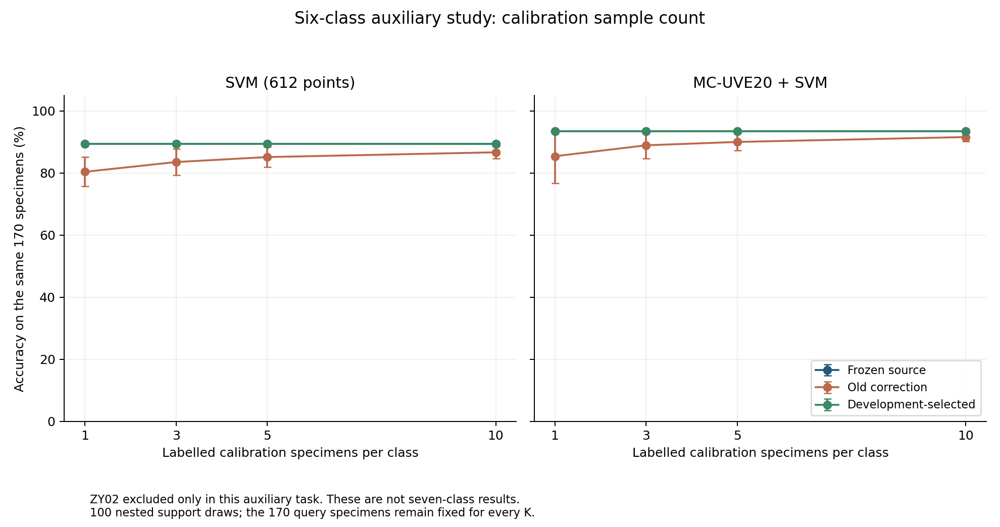

# 小样本校准探索：反复验证、标签对照与实际收益

执行日期2026-10-31。使用用户提供的真实光谱及ZY01—ZY07匿名标签，原513训练／171校准池／171预测分组不变。已完成116个配置、120次开发源模型拟合、696,000次开发配置评价、9,000次最终场景评价和1,531,800条逐样品预测；算法失败0。所有配置在最终预测评分前锁定，已支持按hash检查断点续跑。

**找到了弱校准的小幅正向线索，但尚未找到通过完整开发选择流程、并在固定预测组上取得平均改善的七类主方案。** 正向线索和全部负结果均保留，不把探索性对照改称最终验证成功。

## 标签确实如何核对

依据用户确认，每份编号对应独立样品，每个文件对应一个匿名产地组。核对7份原件的28张谱表、21份拆分Excel的84张表、编号对照、厚度后缀、元数据、NPZ、三组归属和预测真值，855条记录全部一致。标签审查7117项检查无失败，逐样品溯源见[标签对照CSV](../reports/calibration-optimization/2026-10-31/label-audit/label_lineage.csv)。

用户明确要求当前使用匿名标签，真实省市以后补充。因此这里核实的是**原表到模型标签的对应关系**，没有独立核验实际生长地或植物鉴定；也没有按模型输出修改标签。模型输入只包含光谱数值，编号和文件名仅作定位。

## 本轮如何反复验证

- **七类主实验：**保留ZY01—ZY07，训练513份，校准池171份，预测171份。ZY02只有1份校准及1份预测，统一只能评价每类1份支持样品。
- **六类样本量辅助实验：**单独排除ZY02，按原用途保留510／170／170，比较每类1／3／5／10份。六类重新训练六类分类器，不能把该成绩解释为七类校准提升。
- 每个任务范围、每种源模型均做30个训练组内部开发任务；七类每任务307源／103支持池／103开发预测，六类306／102／102，每任务20次嵌套支持抽样。标准化、MC20、PCA和距离尺度均仅用当前源子集拟合。
- 源模型预先固定为SNV、C=10的SVM及MC20＋SVM，使用原0.1—1.5候选区间α的612点。开发任务内的ZY02源样品仅1份，不执行不可行的内层CV。最终七类复用此前513份训练得到的冻结模型；六类用510份训练样品拟合两个源模型。
- 比较不调整、旧锚定校正、强正则弱混合、误分类偏置、误分类岭回归、局部核残差、收缩原型融合，共116个固定配置。误分类残差方法在支持样品原来全部分对时严格保留原分数；它不保证把所有误分类支持样品都改对。
- 前24个开发任务选参，后6个作开发门禁。候选相对原SVM及自身零支持匹配对照均须平均提高超过0.1个百分点，宏F1和平衡准确率下降不超过0.5个百分点。门禁不通过就保留源模型。原型融合的零支持对照保留同样结构，避免把源特征融合收益冒充新标签收益。
- 所有范围、模型、K及家族配置写入`selection_lock.json`后，才评价固定预测样品。每个K做100次支持抽样，预测集不随抽样改变。最终指标没有用于挑种子、调整阈值、筛支持样品或更换主方法。

训练组内部开发和最后6个任务都是开发过程，不是独立外部验证。各任务共享原有样品，也不能将120个开发模型称为120批独立药材。

## 七类：主方案没有提升，弱校准对照出现小收益

所有校准数值为100次支持抽样的均值，各方法使用相同171份预测样品。

| 源模型／对照 | 准确率 | 比源模型变化 | 提高／不变／下降次数 | 结果身份 |
| --- | ---: | ---: | ---: | --- |
| SVM源模型 | 88.8889%（152/171） | — | — | 冻结基线 |
| SVM开发流程主选择 | 88.8889% | 0 | 0／100／0 | 回退为不调整，未使用校准标签拟合 |
| SVM强正则弱校正，λ=1000、混合0.05 | **89.0994%** | **+0.2105个百分点** | **36／64／0** | 预先指定的家族诊断，未达到第一阶段开发选择门槛 |
| SVM低强度误分类偏置，强度0.1、间隔门限1 | 89.0000% | +0.1111个百分点 | 19／81／0 | 预先指定的家族诊断，未通过开发选择标准 |
| SVM旧λ=1校正 | 76.4971% | −12.3918个百分点 | 0／0／100 | 负面对照 |
| MC20＋SVM源模型／开发主选择 | 87.7193%（150/171） | 0 | 0／100／0 | 回退为不调整 |
| MC20＋SVM旧λ=1校正 | 74.4854% | −13.2339个百分点 | 1／0／99 | 负面对照 |

弱校正的宏F1为0.8644，源模型为0.8616；平衡准确率约86.69%，源模型约86.43%。这两个辅助指标也有小幅改善。

**为什么正向对照没有成为主选择？** λ=1000、混合0.05在前24个开发任务中平均仅提高0.0364个百分点，低于预先规定的0.1个百分点；后6个门禁任务提高约0.2670个百分点。不能看到最终预测有利后，再降低第一阶段门槛或把这个对照改成先前选出的主方法。误分类偏置的开发增益也很小，约0.0182个百分点。



本轮旧λ=1对照使用新的100次抽样，种子20261105，与上一轮20次、种子42的均值不同。上一轮结果保持原记录，没有用本轮数值覆盖。

## 正增益具体来自哪里

两种正向家族对照的全部改动都涉及同一份预测样品：

| 样品 | 原表真实匿名标签 | SVM原预测 | 弱校准后的变化 |
| --- | --- | --- | --- |
| ZY07-057 | ZY07 | ZY05，错误 | 强正则弱校正在36次抽样中改为ZY07，其余64次不变；误分类偏置在19次改为ZY07，其余81次不变 |

其他170份的预测在这两项对照中没有变化，因而没有新增误判。该样品原始SVM的ZY05分数为5.223710，ZY07分数为5.216214，两者仅差约0.00750，属于当前分数规则下的边界样品。弱修正足以改变它的判别，同时没有在这批预测样品上扰动其他类别。

这支持继续研究**强约束、小幅修正、保护原判别**，但不能从一个获益样品推断普遍产地性能提升。相应55条改动记录是事后解释性诊断，不是随机样品展示；没有据此挑选生产用支持样品。记录见[全部改动CSV](../reports/calibration-optimization/2026-10-31/exploratory_changed_predictions.csv)。

## 六类：增加校准样品减少旧方法的损害，但未保证提高

六类任务不含ZY02，不能与七类准确率直接比较。六类SVM源准确率89.4118%，MC20源准确率93.5294%。

| 每类校准数K | 六类SVM旧λ=1校正均值 | 六类MC20旧校正均值 | 开发选出主方案的实际结果 |
| --- | ---: | ---: | --- |
| 1 | 80.4118% | 85.4353% | 两模型均不调整，保持各自源准确率 |
| 3 | 83.5647% | 88.9588% | 两模型均不调整 |
| 5 | 85.1706% | 90.0471% | 两模型均不调整 |
| 10 | 86.7000% | 91.6176% | SVM选λ=10、混合0.1，最终89.3765%；MC20不调整 |

SVM的10-shot主候选在开发阶段通过标准，但最终比源模型微降0.0353个百分点，100次中94次不变、6次下降、0次提高。这说明开发通过也不保证固定预测组上涨。增加K使旧方法的表现逐步接近源模型，却没有越过源模型；不能写成“校准样品越多，准确率必然更高”。



## 每个样品如何与标签比对

所有预测先由只接收数值光谱／源分数的适配接口生成，再在评分边界通过记录ID连接原标签，计算`is_correct=(y_predicted==y_true)`。最后准确率就是该预测场景中正确样品数除以171或170；100次均值是支持样品抽样均值，不是新增独立样品数。

每个范围预先按种子20261102随机选20份展示样品。400条模型／K／前后展示记录全部保留，包含24条错误预测记录；它们不是24个不同独立样品。没有只展示正确样品。全量逐样品预测以10个分片CSV.gz保存，避免单张Excel超过行数限制。

可直接查看[校准探索_预测与标签对照.xlsx](../reports/calibration-optimization/2026-10-31/校准探索_预测与标签对照.xlsx)：含90行关键汇总、400行随机对照、3078行七类逐样品统计及55行改动记录。每份样品列出提供的标签、原预测、校正后预测及是否正确，错误行保留并标色。CSV版见[随机样品](../reports/calibration-optimization/2026-10-31/random_sample_label_comparison.csv)及[七类逐样品统计](../reports/calibration-optimization/2026-10-31/seven_class_per_sample_statistics.csv)。

## 复核、交付与继续运行

132项测试通过。独立审查重新核算1,531,800条预测、9000组指标和90组汇总，9,383,871项检查无失败，最大指标差`4.44e-16`；另独立重聚合696,000条开发评价、重算10个主选择及70个家族选择／门禁，最大均值差`5.66e-15`。源模型指纹、固定分区、100次嵌套支持抽样、候选锁和标签均一致。

实际新增源分类器拟合为120个开发模型和2个六类最终模型；七类两个源模型直接复用。696,000为配置评价次数，不是696,000个独立源模型。完整运行约182秒，另完成已结束任务的`--resume`检查，未重新拟合。代码支持中断后核对输入、协议、依赖、源模型及源码hash再继续。

入口为[协议](CALIBRATION_OPTIMIZATION_PROTOCOL.md)、[机器配置](../data/research/calibration_optimization_protocol_20261031.json)及[完整证据目录](../reports/calibration-optimization/2026-10-31/README.md)。六类源模型另存[模型目录](../models/calibration_optimization_20261031/README.md)，不替代七类模型。原始855份数据、三组Excel及上一轮报告均不变。

在项目依赖环境、仓库根目录下复现到新目录：

```bash
python scripts/prepare_zaoren_dataset.py --output outputs/calibration-source-reproduced
python scripts/run_calibration_optimization.py --input outputs/calibration-source-reproduced/dataset.npz --split-plan data/processed/zaoren_threeway_20261031_v1/split_plan.json --protocol data/research/calibration_optimization_protocol_20261031.json --output outputs/calibration-exploration-reproduced
```

恢复同一任务时，保持全部输入与代码不变，在相同命令末尾加`--resume`。若数据版本或算法改变，应记录新协议并使用新输出目录；不能把旧检查点当成新数据结果。

当前最值得保留的线索是SVM的强正则弱校正及误分类偏置，而不是继续采用大幅线性校正。下一轮若继续改算法，当前171份已看过的预测样品仍只能用于回顾性探索；稳定七产地改善与跨批次结论需要新的独立确认样品，并优先补足ZY02。
