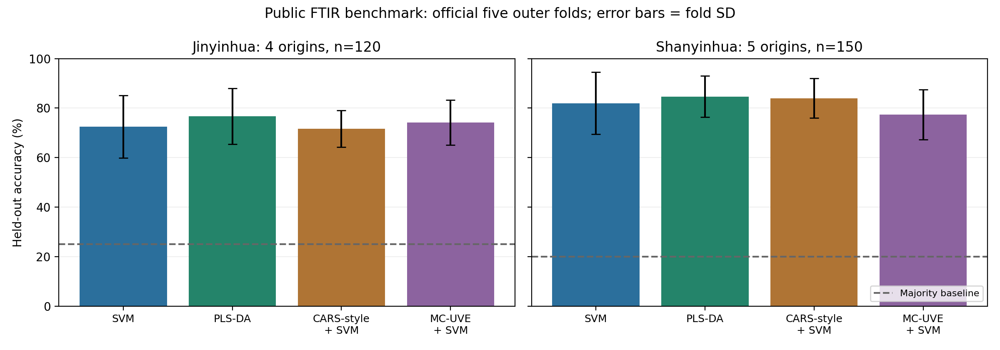
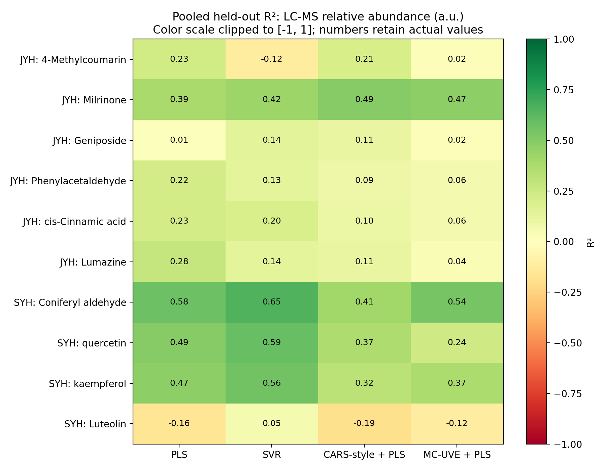

# 外部中药光谱数据集：真实运行与指标报告

日期：2026-10-30。执行平台：当前云端 Python 3.12 / scikit-learn 1.8 / Octave 9.4，CPU。结果来自实际训练和保存的外层测试预测；没有使用原论文的分数代替本次计算。

本轮完成 **330 个正式场景**：50个Python分类、250个Python回归、30个归档Octave核心调用，全部执行通过。另有20个首折运行检查，不重复计入正式数量；54项单元测试通过。执行通过与预测性能分别判断。

## 来源与适用范围

主数据来自 [UltraIR官方仓库](https://github.com/AIMS-Lab-HKUSTGZ/UltraIR)，固定提交 `f9e52429f325ee408045359bf8d5ac67e25bdc53`，对应 [Tan等，2026年预印本](https://arxiv.org/abs/2608.13341)。已下载并校验120个NumPy数组及9份文档/配置，无Git LFS指针。源仓库明确源码MIT；未找到单独的数据许可说明，因此本仓库保留下载器、来源与hash，原数组留在忽略的outputs目录。

| 数据任务 | 光谱行数 | 标签 | 官方每折train/valid/test |
| --- | ---: | --- | --- |
| 金银花产地 | 120 | 山东、河南、河北、四川，各30条 | 72/24/24 |
| 山银花产地 | 150 | 湖南、湖北、四川、河南、广东，各30条 | 90/30/30 |
| 金银花相对丰度 | 60 | 6个LC-MS目标 | 36/12/12 |
| 山银花相对丰度 | 75 | 4个LC-MS目标 | 45/15/15 |

四组均为1868点FTIR百分透射率。它们不是黄芪数据，也不是太赫兹数据。分类集合包含全部相应回归谱，不能把四行相加当作独立样品总量。作者回归标签是LC-MS相对丰度，单位a.u.，不是mg/g绝对含量；化合物名称按原YAML标签保留，未独立核验峰身份、标准品确认或化学定量准确性。未公开波数轴，筛选结果仅报告零起始索引。

源资料没有物理样品编号、重复扫描分组或批次编号。本次无精确跨分区重复谱，各任务五折全体谱集合相同且每条谱恰好测试一次；这些检查不能证明不同谱来自独立药材样品。当前属于按作者光谱行划分的五折基准，不能宣称跨批次、跨仪器或独立物理样品泛化。

## 评测协议

1. 保留作者五个外层test；每折将原train与valid合并，得到分类96/120条、回归48/60条的建模池，在池内重新三折调参。每个模型相同外层和内层划分。该流程没有复现UltraIR原论文的模型、预训练、验证集选checkpoint或完整调参协议。
2. 固定转换 `A=-log10(T/100)`，保留全部1868点，不插值缩放长度。Python模型在训练内比较原吸光度/SNV；StandardScaler、选择器和模型组成完整Pipeline，在每个内层训练折重新拟合。最终外层test仅用于评价。
3. SVM/SVR的C候选为0.1/1/10/100，gamma=scale；PLS/PLS-DA潜变量候选为1/2/3/5/8，按样本及特征上限裁剪。SVR的目标标准化只拟合训练目标，报告时还原原单位。
4. Python CARS-style固定12轮、选择器PLS潜变量2、内部CV=3；MC-UVE固定20轮、潜变量2，保留10%变量（本数据187点）。CARS＋PLS下游潜变量限1/2以适应最小子集。选择器参数为首测预算，未为每个测试集另行扩展。
5. 分类CARS-style/MC-UVE使用one-hot多分类目标，PLS-DA采用one-hot PLS2后argmax；没有把产地编号作为连续含量。均为已注明来源关系的Python适配/独立实现。
6. 对全部6＋4个回归目标运行全部五种方法，没有依照测试成绩挑选目标。另预设每种药材第0列做Octave核心对照，覆盖其五折。
7. 每个模型按五个外层test拼接OOF预测后重算总体指标；R²不是五个折R²的平均。折标准差只描述分区间变化，不是置信区间，五个训练区间存在重叠。共享下游网格不代表相同计算量，选择器有额外拟合工作。

## 产地分类结果

表中准确率为五折拼接后的OOF准确率，括号为五折准确率标准差，单位百分点；macro-F1与MCC也从拼接预测重算。各产地谱行数均衡，本数据的平衡准确率与准确率相等。

| 药材 | 模型 | 准确率（%）±折SD | macro-F1 | MCC | macro-precision | 平均使用点数 |
| --- | --- | ---: | ---: | ---: | ---: | ---: |
| 金银花 | 多数类/均值基线 | 25.00 ± 0.00 | 0.1000 | 0.0000 | 0.0625 | 1868.0 |
| 金银花 | SVM | 72.50 ± 12.71 | 0.7231 | 0.6343 | 0.7249 | 1868.0 |
| 金银花 | PLS-DA | 76.67 ± 11.26 | 0.7588 | 0.7018 | 0.8099 | 1868.0 |
| 金银花 | CARS-style＋SVM | 71.67 ± 7.45 | 0.7156 | 0.6236 | 0.7194 | 33.6 |
| 金银花 | MC-UVE＋SVM | 74.17 ± 9.03 | 0.7396 | 0.6573 | 0.7436 | 187.0 |
| 山银花 | 多数类/均值基线 | 20.00 ± 0.00 | 0.0667 | 0.0000 | 0.0400 | 1868.0 |
| 山银花 | SVM | 82.00 ± 12.61 | 0.8209 | 0.7758 | 0.8248 | 1868.0 |
| 山银花 | PLS-DA | 84.67 ± 8.37 | 0.8469 | 0.8101 | 0.8555 | 1868.0 |
| 山银花 | CARS-style＋SVM | 84.00 ± 7.96 | 0.8402 | 0.8007 | 0.8434 | 92.8 |
| 山银花 | MC-UVE＋SVM | 77.33 ± 10.11 | 0.7754 | 0.7183 | 0.7844 | 187.0 |



PLS-DA在本次两个数据集中的总体数值最高；山银花PLS-DA与CARS-style＋SVM相差仅1条测试谱（127/150与126/150），不能据此认定存在稳定或显著优势。金银花CARS-style＋SVM比全谱SVM低0.83个百分点，MC-UVE高1.67个百分点；山银花两者分别高2.00、低4.67个百分点。变量筛选没有在两个数据集上同时稳定提高准确率。

## 相对丰度回归：全部目标

下表全部为总体OOF R²。Dummy是各训练区均值预测。完整RMSE、MAE、R²、预测偏差和RPD见 [机器可读CSV](../reports/external-benchmarks/2026-10-30/pooled_metrics.csv)。不同目标单位虽均写a.u.，量级不同，不能直接比较其RMSE大小来判断哪个成分更容易预测。

| 药材与原标签 | 均值基线 | PLS | SVR | CARS-style＋PLS | MC-UVE＋PLS |
| --- | ---: | ---: | ---: | ---: | ---: |
| 金银花 / 4-Methylcoumarin | -0.0382 | 0.2315 | -0.1200 | 0.2097 | 0.0169 |
| 金银花 / Milrinone | -0.0207 | 0.3888 | 0.4246 | 0.4948 | 0.4740 |
| 金银花 / Geniposide | -0.0316 | 0.0094 | 0.1436 | 0.1118 | 0.0201 |
| 金银花 / Phenylacetaldehyde | -0.0301 | 0.2222 | 0.1334 | 0.0915 | 0.0579 |
| 金银花 / cis-Cinnamic acid | -0.0301 | 0.2262 | 0.1988 | 0.0991 | 0.0562 |
| 金银花 / Lumazine | -0.0338 | 0.2753 | 0.1401 | 0.1130 | 0.0361 |
| 山银花 / Coniferyl aldehyde | -0.0536 | 0.5762 | 0.6498 | 0.4096 | 0.5442 |
| 山银花 / quercetin | -0.0321 | 0.4942 | 0.5892 | 0.3652 | 0.2377 |
| 山银花 / kaempferol | -0.0356 | 0.4727 | 0.5582 | 0.3182 | 0.3729 |
| 山银花 / Luteolin | -0.0154 | -0.1572 | 0.0489 | -0.1888 | -0.1158 |



预设第0目标的误差明细如下；它们是固定选定的展示目标，不是根据测试成绩挑出的最佳成分。Bias定义为预测减真实值的均值；RPD定义为总体测试目标样本标准差（ddof=1）除以RMSE。

| 药材与目标 | 模型 | RMSE（a.u.） | MAE（a.u.） | R² | Bias（a.u.） | RPD |
| --- | --- | ---: | ---: | ---: | ---: | ---: |
| 金银花 / 4-Methylcoumarin | PLS | 1047.094 | 875.473 | 0.2315 | 11.073 | 1.150 |
| 金银花 / 4-Methylcoumarin | SVR | 1264.078 | 976.749 | -0.1200 | -42.190 | 0.953 |
| 金银花 / 4-Methylcoumarin | CARS-style＋PLS | 1061.865 | 886.079 | 0.2097 | -57.973 | 1.134 |
| 金银花 / 4-Methylcoumarin | MC-UVE＋PLS | 1184.305 | 1002.595 | 0.0169 | -100.389 | 1.017 |
| 山银花 / Coniferyl aldehyde | PLS | 874.249 | 674.336 | 0.5762 | -39.029 | 1.546 |
| 山银花 / Coniferyl aldehyde | SVR | 794.657 | 567.427 | 0.6498 | 30.786 | 1.701 |
| 山银花 / Coniferyl aldehyde | CARS-style＋PLS | 1031.812 | 809.079 | 0.4096 | -14.578 | 1.310 |
| 山银花 / Coniferyl aldehyde | MC-UVE＋PLS | 906.657 | 680.675 | 0.5442 | 86.059 | 1.491 |

金银花Geniposide的PLS R²约0.009，山银花Luteolin的SVR也只有约0.049，不能视为实用定量模型；山银花Luteolin的其他三种方法为负R²。负值表示总体OOF平方误差超过使用该OOF真实总体均值的参照误差；各训练折均值基线仍单独列出，二者并非完全同一预测器。

## 老师归档核心的Octave对照

实际调用 `0308 CARS+UVE.rar` 中的PLS、MC-UVE与CARS核心，保留原逻辑，工作副本进行编码转换并补sumsqr兼容函数。原归档SHA和逐依赖源文件/工作副本SHA均记录。Octave输入只包含X_train、y_train、X_test，不含y_test；指标由Python读取保存的外层预测后计算。

固定PLS潜变量2并使用center；MC-UVE20轮、取前10%且最多100点；CARS12轮、内部3折，明确使用originalVersion=0简化分支，最终预测PLS仍为2潜变量。它们与Python版本的目标/特征缩放、选择策略、潜变量调参及保留数量有差异，结果不能解释为等设置下Python优于Octave或数值复现失败。

| 药材与第0目标 | 归档核心 | RMSE（a.u.） | MAE（a.u.） | R² |
| --- | --- | ---: | ---: | ---: |
| 金银花 / 4-Methylcoumarin | 归档简化CARS＋PLS | 1205.759 | 1085.128 | -0.0191 |
| 金银花 / 4-Methylcoumarin | 归档MC-UVE＋PLS | 1255.226 | 1139.203 | -0.1044 |
| 金银花 / 4-Methylcoumarin | 归档PLS（LV=2） | 1239.962 | 1131.119 | -0.0777 |
| 山银花 / Coniferyl aldehyde | 归档简化CARS＋PLS | 1151.994 | 910.470 | 0.2641 |
| 山银花 / Coniferyl aldehyde | 归档MC-UVE＋PLS | 1163.002 | 932.782 | 0.2500 |
| 山银花 / Coniferyl aldehyde | 归档PLS（LV=2） | 1112.600 | 866.608 | 0.3136 |

这些原核心共30/30次执行完成；金银花首目标的三种总体R²都为负，因此执行成功不能写成已经建立有效定量模型。

## 对论文主线的含义

- 产地鉴别可以先用SVM与PLS-DA共同建立基线，并保留CARS/MC-UVE的增益检验；当前不宜预设筛选器或复杂优化器一定更好。
- 当前基准没有批次与仪器域信息，没有实际执行小样本跨域校准，不能以本轮随机行级五折成绩支持跨批次泛化。后续仍需各产地多个批次、独立物理样品与严格support/query设计。
- 真实绝对含量研究仍需要逐样品对应、标准方法验证的化学参考值；不能把本轮相对丰度结果改名成药典含量预测。
- 本轮未将SSA、BP、CNN或UltraIR预训练模型纳入正式外部比较，未搜索到“最佳可能精度”；已测模型、网格、预算和全部正负结果完整保留。

## 复现与证据

在仓库根目录使用新输出目录运行，已有目录非空时程序拒绝覆盖：

```bash
python scripts/setup_research_environment.py
.runtime/bin/python scripts/prepare_external_benchmarks.py --download
.runtime/bin/python scripts/run_external_benchmarks.py --spec outputs/external-benchmark-inputs/spec_classification.json --output outputs/external-classification-new
.runtime/bin/python scripts/run_external_benchmarks.py --spec outputs/external-benchmark-inputs/spec_regression.json --output outputs/external-regression-new
.runtime/bin/python scripts/runtime/prepare_sources.py --output outputs/external-legacy-sources
.runtime/bin/python scripts/runtime/run_external_octave.py --spec outputs/external-benchmark-inputs/spec_octave.json --inventory outputs/external-legacy-sources/source_inventory.json --octave .runtime/bin/octave --output outputs/external-octave-new
.runtime/bin/python scripts/summarize_external_benchmarks.py --classification outputs/external-classification-new --regression outputs/external-regression-new --octave outputs/external-octave-new --spec outputs/external-benchmark-inputs/spec.json --output outputs/external-summary-new
```

汇总器可加 `--plots` 导出PNG/PDF；本次绘图使用Matplotlib3.10.8，核心模型不依赖绘图库。不同平台、BLAS及软件版本可能带来浮点差异。

本次数据准备另外经过独立逐元素复核；全部50个分类及250个回归场景从预测CSV独立复算，回归指标最大绝对差为0。保存的逐行OOF预测、全部逐折指标、混淆矩阵、类别召回率、内部划分、来源/代码hash、Octave调用脚本与日志见 [证据目录](../reports/external-benchmarks/2026-10-30/benchmark_summary.json)。

较大的逐折原始JSON无损保存为`.json.gz`，可用Python的gzip模块或解压软件读取；`compressed_artifacts.json`记录原文件名与解压后SHA-256，`files_sha256.json`核验归档文件。总体指标JSON与CSV可直接阅读。

补充检索到OliveOil、Coffee、Tecator及药片跨仪器数据，本轮未计入已执行模型结论；检索记录单独归档。
