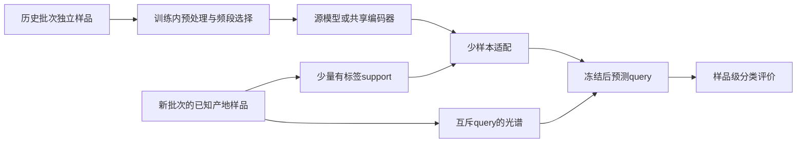

# 少样本光谱基准论文精读与酸枣仁课题适配

> **后续实测更新（2026-10-31）：已完成[论文启发的分类试验](PAPER_FEWSHOT_CLASSIFICATION_REPORT.md)，提供实际ProtoNet／一阶MAML／微调结果。本页“未运行”的表述仅指首次审读阶段。独立样品与每产地一批的用户声明已补入当前协议，真实地名仍待补充。**

> **数据版本更新（2026-10-31）：后续酸枣仁研究以[7份编号版](../data/processed/zaoren_20261031/README.md)及[有效工作簿清单](../data/active_workbooks.json)为准，共855条谱记录。** 旧未编号输入仅在`data/archive/zaoren_superseded_20261031/`留作溯源；旧405条记录的检查不能当作新版实测。ZY01—ZY07是用户声明的文件产地组，真实地名、独立样品／重复关系与批次仍须补足。用户已决定本轮主线暂不加入Gaussian。

核验日期：2026-10-30。基于用户上传的13页PDF全文，并只读核查作者公开代码的固定快照。下文页码为PDF页码。本轮没有运行新模型、Gaussian计算或作者的下载／训练脚本。

论文：Garzón, I., Gomez-Trenado, G., Damas, S. **A task-oriented few-shot spectroscopy benchmark: Empirical evaluation of meta-learning approaches**. *Engineering Applications of Artificial Intelligence*, 167（2026）, 113593. [DOI](https://doi.org/10.1016/j.engappai.2025.113593)，[本次上传原文](../references/research-literature/fewshot-benchmark-2026/1-s2.0-S0952197625036255-main.pdf)。PDF首页注明2026-01-29在线发表及CC BY许可。

## 最值得借鉴什么

**优先借鉴任务定义、support/query隔离、支持样本量曲线和方法对照，再决定是否使用元学习。** 当前可将酸枣仁主问题收紧为：在已知生长产地类别下，用少量新批次独立样品校准源模型，评价其余独立样品的识别效果。

本文是近／中红外的**连续属性回归**，不是太赫兹产地分类。第3节与§3.5（p.3、5）明确标量回归目标；5／10／25-shot是每任务共5／10／25个有连续参考值的支持实例，不是每类样品数。主文没有实证1／3-shot。你的分类需要类别标签、分类损失和样品级分类指标。

作者的主要贡献是组织跨任务基准和比较学习策略，不是发明MAML或ProtoNet本身。其摘要“持续优于”的表述应结合表格阅读，不能作为方法必胜或本课题新颖性的证明。

## 数据与方法：任务比文件数更重要

§3.1、Table 1及Fig.1（p.3–4）汇集9个数据源，标示总计111,767条谱、925个任务表示：

| 测试组 | 预测问题及任务组织 | 数据规模 |
| --- | --- | --- |
| Mango | 干物质百分比，按年份及年份×地区组织 | 11,691条谱；4个年份＋8个年份／地区任务 |
| Soil | 不同地区的土壤属性回归，分别用NIR／MIR | 88,867条谱；185个NIR＋704个MIR任务 |
| TRIP | 燃油、玉米、药片等不同数据／属性的回归 | 11,209条谱；24个任务 |

任务数不等于独立物理样品数。Mango两种切法共享原数据，多种化学属性也可能使用相同X；925个任务不表示925个独立批次。Table 1将部分数据随机50%划support/query，其余保留原划分；精确元训练／验证／测试任务成员和各数据细节指向独立补充材料。

§3.2（p.4）采用SG一阶导数及逐任务连续y标准化。主文未完整交代均值／方差的拟合分区与跨数据频轴／输入长度对齐。对我们的THz数据，应在可信共同频段比较；原谱、SG、SNV等在训练内选择，不能预设导数一定更好。产地类别不做连续y标准化。

§3.3、Table 2（p.4–5）用MMD与FIS描述任务差异：

- **MMD**是在给定表示与核下比较输入分布，不是普适物理距离。产地比例不同也会改变它，分类时宜在匹配类别组成或同类条件下比较批次。
- **FIS**使用各波段与连续y的Pearson相关向量，再比较余弦相似度。产地编号1／2／3没有连续大小含义，不能照搬；应改用编码不变的分类重要性，或固定类别顺序的one-hot关联，且只用训练标签。

本文没有建立“某个MMD阈值以上必选MAML”的通用规则。

### 同样少量标签，不同适配方式

§3.4–3.5（p.5）和§4.1比较以下方法，共用ResNet1D表示。采用相同主干不代表各方法的源信息与计算预算自动完全一致。

| 方法 | 本文含义 | 对产地分类的启发 |
| --- | --- | --- |
| Individual | 仅用目标任务少量样品训练，无预训练 | 保留简单目标小样本基线 |
| Fine-tuning | 源任务预训练后，用目标support更新模型 | 优先比较全网微调、冻结表示重训头和分数校准 |
| MAML | 用多源任务的support适配与query损失学习易适配初始化 | 需要可信的任务多样性，并更换分类损失／输出头 |
| ProtoNet | 学习距离表示，按支持样本距离预测连续目标 | 回归实现不能直接当产地类别原型 |
| SNAIL | 时序卷积＋注意力处理支持信息 | 本文有严重不稳定的负结果，暂不列首选 |
| SimCLR＋MLP | 对比预训练、冻结编码器，用support训练两层MLP回归头 | 可作标签利用对照；增强应保留有效物理信息 |
| SimCLR＋PR | 对比预训练后用支持样本距离推断，无进一步梯度训练 | 与全网微调是不同适配策略 |

§4.1采用25支持实例和适配epoch设置，不能把梯度更新轮数机械套给不微调编码器的方法。结构及完整超参数多见单独补充材料。

## 真实结果：元学习并非始终更好

Table 3（p.6）含MSE／MAE／R²，Table 4（p.7）报告5／10／25-shot的R²。下表均为论文报告值，不是本项目复现结果或产地准确率。y经过标准化，跨任务MSE／MAE不能直接改称某成分的mg/g误差。

| 原文设置 | 论文数值 | 应如何理解 |
| --- | --- | --- |
| Table 3，Mango年份，25-shot | FT R²＝0.679；ProtoNet＝0.826 | 此设置原型方法更好 |
| Table 3，Soil-NIR，25-shot | FT MSE＝0.745；MAML＝0.759 | MAML在此指标略差于FT |
| Table 3，TRIP，25-shot | MAML MSE＝0.555；ProtoNet＝0.580 | ProtoNet不是所有指标最佳 |
| Table 4，Mango，5-shot | FT R²＝0.575；ProtoNet＝0.424 | 极少支持时，FT可以超过ProtoNet |
| Table 4，TRIP，5-shot | MAML R²＝−0.095；ProtoNet＝−0.115 | 此列全部方法为负，5个样品不保证可靠预测 |
| Table 4，Soil，5-shot | SNAIL R²＝−260.705 | 严重不稳定的负结果需要保留 |

Table 3的TRIP ProtoNet相对FT的MSE下降约80.5%，不是分类准确率提高80个百分点；相对Individual的MSE下降约23.6%。

三处阅读边界：①Table 3题注报告α＝0.05临界差异分析，ProtoNet与MAML同最高组、二者无显著差异，统计过程在未取得的Appendix C；②Table 4 Mango 25-shot不是Table 3两种Mango切分的简单均值，原因待补充材料／代码核对，不能拼接成同一实验；③Fig.6／§4.6为合成扰动，不等于真实新仪器验证，Fig.7／§4.7是单个Mango实例的定性归因。完整表格见[results.json](../reports/literature/fewshot-benchmark-2026/results.json)。

## 酸枣仁方案：先定义正确的分类任务

一个任务应是某种采集／测量条件下的多产地分类问题。每个实验批次尽量覆盖相关产地；物理批次若只含一个产地，应按明确采集条件组织多个产地批次，不能把“河北文件”单独当作一个完整多分类任务。

分类K-shot定义为**每类K个独立样品**。假设4个已核验产地、每类3个，则共12个支持样品；这只是计数示例，不代表当前已确认4个产地或独立样品数。

“已知产地的新批次”与“训练中从未出现的新产地类别”分别设计；普通固定类别SVM不会自动输出未训练过的产地，新增类需开放集或小样本增类协议。

### 支持集与查询集规则

1. 按物理样品／压片ID归组重复扫描，再划源、验证及最终目标批次，同一样品不能跨集合。
2. 每个目标批次先固定独立query，再设互斥最大support池。各方法用相同query，K＝1／3／5／10等采用嵌套支持子集；这些是本课题候选，不是本文已验证的每类K-shot。
3. 预处理、选频段、表示、正则和适配参数只用源域／验证任务选择。最终query标签仅评分；使用目标query无标签分布也需另声明传导式设置。
4. **元训练任务query可参与外层训练损失；最终目标query只能评分。** 两者不能混为“query永远不训练”或“query参与训练都可以”。
5. 重抽support表示支持集敏感性，独立物理批次表示跨批次变化；重复抽样不增加独立批次数。以真实样品／批次估计不确定性。

### 模型取舍与现有代码衔接

| 阶段 | 具体工作 | 条件 |
| --- | --- | --- |
| 先做 | SVM／PLS-DA基线，n、α、拼接对照，训练内CARS／MC-UVE | 需补物理ID、唯一产地及批次映射 |
| 再做 | 源模型不校准、简单目标support模型、源＋support完整重训、冻结源表示重训头、分数锚定校准 | 区分完整重训与仅重训头，明确源知识使用 |
| 简单原型候选 | 在PCA或轻量1D表示中比较源类别中心、support类别中心及收缩混合 | 不经episodic训练就称原型适配基线，不称完整元学习 |
| 条件成熟后 | 比较分类ProtoNet，再决定是否MAML；统一主干、源信息与搜索预算 | 真实任务多样性不能由重复扫描或随机拆文件虚构 |

分类ProtoNet是在表示空间中对每个产地的支持样品求中心，按距离输出类别；作者回归代码按距离加权连续支持值。收缩强度、距离尺度等只在源验证任务调节，不凭最终query挑最优。

现有`AnchorScoreCalibrator`可作为已知类别分数校准候选，分数不自动是概率；`ShrinkageAffineCalibrator`是连续回归模块，不用于产地整数的斜率／偏差校准。工程和外部回归实测不证明真实酸枣仁跨批次分类校准已成功。

主指标为宏平均F1、平衡准确率、各产地召回率和混淆矩阵，另报相对源模型的增益／负增益、训练与适配耗时。将来取得HPLC连续含量后可另开回归任务，此时本文回归模型与指标更直接对应。

## 此前讨论的化学解释分支（当前暂缓）

本节保留此前讨论供参考，按用户后续决定不纳入当前识别—改进—小样本校准主线。本文没有Gaussian量子化学计算；Gaussian核／噪声是数学术语。§4.7（p.8）及Discussion明确SHAP／XGrad-CAM是模型归因线索，不作确定化学峰归属。

结合路径：**训练中稳定重要的THz频段 → 标准品／化学检测筛选候选解释 → 合适的分子或固态计算检验 → 冻结频段／解释方案 → 独立批次少样本评价。** 当前只有GaussView界面，没有Gaussian引擎或频率结果；模拟不能增加真实产地标签、独立样品或任务。

SVM的置换重要性／适用SHAP方法与卷积网络XGrad-CAM需分别选择。n和α来自同一测量链，增强应保持频轴与配对关系；合成扰动与真实批次结果分开报告。

## 作者代码：移植前需核对的条件

只读快照[`main@1377132`](https://github.com/ivgase/spectroscopy-fewshot-benchmark/tree/13771327980ba904641dcdec3037822d4baec34f)提交于2026-09-06，晚于论文在线发表，不自动视为论文冻结版本。读取README和5个核心源文件，未执行；SimCLR实现未在本次代码范围核查。

- `models/protonet.py`输出距离权重乘连续支持值，不是类别原型分类。
- `datasets_fewshot.py`先用完整support池拟合y标准化再抽K个实例。严格仅K个目标标签的条件需要重写或披露；这是额外support标签统计量，不直接等同query泄漏。对仿射加权回归和R²的影响也需逐模型判断，不能据此宣布全部结果无效。
- FT目标query评分在`no_grad`中；传入query作记录不证明用于训练或挑最优。源support／query在FT与元训练中的用途不同，需匹配和披露源标签及验证预算。
- 有硬编码CUDA和预处理默认差异，不能称已在当前CPU云端直接运行；固定行抽样和缓存也不保证物理样品独立。

代码行号、永久链接与文本哈希见[author_code.json](../reports/literature/fewshot-benchmark-2026/author_code.json)。这是限定范围审查，不是完整软件审计或原论文全部结果复现。

## 当前最先推进的事项

用户已确认相关地名为生长地，并说明当前每份工作簿对应一个产地。后续只用7份编号版：ZY01有350条、ZY02有5条、ZY03—ZY07各100条，共855条谱记录。仍需每条谱的真实地名、物理样品／压片、重复扫描、制样／测量批次和仪器映射；七个Excel不等于七个元训练任务，855条记录不等于855个独立样品。

先完成映射与样品级基线，再做固定query的小样本曲线，有真实多批次任务后再比较分类ProtoNet／MAML。当前候选筛选及适配机制仍待验证，不能凭组合宣称首次或新算法；分子计算与理论频段先验不列入本轮实验。

审读记录：[原文与来源](../references/research-literature/fewshot-benchmark-2026/README.md)、[方法及页码](../reports/literature/fewshot-benchmark-2026/methods.json)、[结果表](../reports/literature/fewshot-benchmark-2026/results.json)、[适配方案](../reports/literature/fewshot-benchmark-2026/adaptation.json)、[范围及零新增运行记录](../reports/literature/fewshot-benchmark-2026/source_metadata.json)。上传13页不含独立Appendix A–D，出版社直接访问受限，本轮未取得／阅读补充材料。
