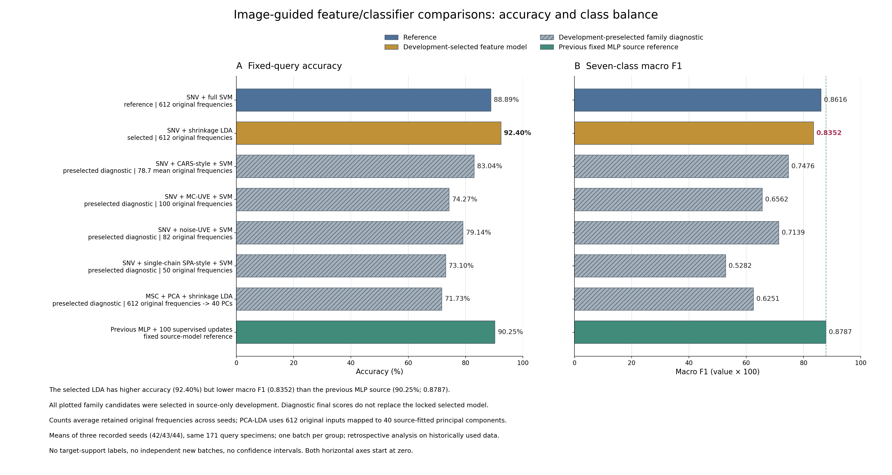
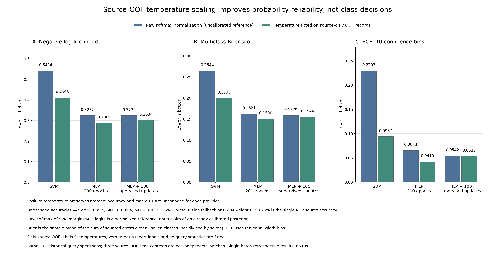

# 图片建议的三条优化路径：实际结果

2026-10-31。已按三张图片完成**81个主要设置**及控制：特征筛选40、概率／判别21、概率融合20。使用原855份真实光谱和匿名ZY01—ZY07，513训练／171校准池／171预测及612点候选频段均未调整。

**SNV＋收缩LDA达到158／171＝92.40%正确率，但宏F1为0.8352，低于原SVM的0.8616和既有较强MLP的0.8787。源温度缩放改善了概率质量，分类保持不变；融合候选未通过开发检验，正式回退较强单MLP。** 本轮没有得到同时改善总体正确率与宏F1的新主模型，也没有使用目标校准池标签。

当前预测组此前已曝光、每产地只有一批，结果属于同批次回顾性探索。每个种子重复评价同171份样品，不增加独立样品或批次数。

## 图1：SNV／MSC、CARS／UVE／SPA、LDA／PCA-LDA

比较两种预处理下的全谱SVM、CARS-style、MC-UVE、加噪声阈值UVE、单链SPA、均匀／经验先验收缩LDA及PCA10／20／40-LDA。MSC参考谱、缩放和全部变量选择均只拟合源样品。主选择按宏F1进行，准确率和平衡准确率同时受约束。

以下为**开发阶段已锁定**的正式方法、参考及各家族诊断，三个种子的均值；没有按最终分数挑家族配置。

| 方法 | 身份 | 变量／表示 | 准确率 | 宏F1 |
| --- | --- | --- | ---: | ---: |
| SNV＋SVM | 参考 | 612点 | 88.8889% | 0.8616 |
| SNV＋均匀先验收缩LDA | 本轨开发选中 | 612点 | **92.3977%** | **0.8352** |
| SNV＋CARS-style＋SVM | 预选诊断 | 平均78.67点 | 83.0409% | 0.7476 |
| SNV＋MC-UVE100＋SVM | 预选诊断 | 100点 | 74.2690% | 0.6562 |
| SNV＋噪声阈值UVE＋SVM | 预选诊断 | 平均82点 | 79.1423% | 0.7139 |
| SNV＋单链SPA50＋SVM | 预选诊断 | 50点 | 73.0994% | 0.5282 |
| MSC＋PCA40＋收缩LDA | 预选诊断 | 输入612点、PCA40维 | 71.7349% | 0.6251 |
| 既有MLP＋100次源监督继续训练 | 固定较强对照 | SNV／源缩放／64–32 MLP | 90.2534% | 0.8787 |

LDA在开发前4任务的宏F1为0.7093，参考0.6568；后2任务0.7162，参考0.6549，按先定规则通过。最终却未取得宏F1改善，说明开发选择并不保证最终排序。该LDA三个种子都给出相同分类结果，不应将其当作三批独立验证。

LDA相对SVM每个种子纠正12份样品，同时引入6份新错误，另有2份原错误改变了错误类别。总体多对6份，但ZY02的精确率下降：

| ZY02指标 | 原SVM | 选中LDA |
| --- | ---: | ---: |
| 实际预测样品数 | 1 | 1 |
| 被模型预测为该组的数量 | 1 | 5 |
| TP／FP／FN | 1／0／0 | 1／4／0 |
| 精确率 | 100% | **20%** |
| 召回率 | 100% | 100% |
| F1 | 1.0000 | **0.3333** |

因此“该类召回100%”不代表该类判断可靠。宏F1同时考虑各类精确率与召回率，能够暴露这个问题；但该组只有1份最终样品，其指标本身也很不稳定。

图片中的变量选择建议已实际测试，减少变量没有自动带来更好分类。CARS和SPA是明确记录的独立工程实现；MC-UVE与加噪声阈值UVE分别命名，没有把现成方法或改名包装为原创算法。LDA使用收缩判别分类，并未声称已输出独立六维transform。完整频点、变量数和跨18个开发上下文的选择稳定性均已导出，不能据此直接解释化学峰。

## 图2：概率校准、类别阈值与宏F1

七分类没有直接套用二分类0.5阈值。本轮用`argmax(log p_c+b_c)`或预定类别频率修正进行判别；温度校准则单独评价概率质量。

温度、偏置只拟合源内部三折OOF分数：开发源307份中ZY02仅1份，将它留在各折训练中，不产生其校准行，其他306份各有留出分数。最终源513份中ZY02有3份，可正常三折，513份均有OOF分数。每折重新拟合预处理和分类器，不使用完整源或预测组统计，始终保留七列类别顺序。

三个源模型分别为SVM、200轮MLP、MLP追加100次源监督训练。正温度缩放保持argmax，因此准确率及宏F1不变。以下是最终预测组上的三个种子均值：

| 来源 | NLL：未校准→温度 | Brier：未校准→温度 | ECE：未校准→温度 | 分类准确率 |
| --- | --- | --- | --- | ---: |
| SVM | **0.541355→0.409750** | **0.264373→0.199344** | **0.229348→0.093669** | 88.8889% |
| MLP | 0.323220→0.286883 | 0.162050→0.150038 | 0.065273→0.041867 | 89.0838% |
| MLP＋100次源监督训练 | 0.323178→0.300439 | 0.157944→0.154439 | 0.054153→0.053260 | 90.2534% |

NLL、Brier、ECE均为越低越好。Brier先对七类平方误差求和，再按样品平均；ECE使用固定10个等宽置信桶。SVM原始margin不是概率，其softmax仅为未校准归一化参照。这里的可靠性改善只针对当前数据，不能视作跨批次校准已经有效。

类别偏置改变的是判别，未把偏置后结果冒称校准后验概率。原七列概率及其argmax单独保存；NLL／Brier／ECE依据原概率计算，ECE使用原概率argmax正确性。三源模型的硬分类候选都未通过开发流程，正式保留原判别。预选的较强MLP类别频率修正诊断甚至将准确率从90.25%降到81.48%，宏F1从0.8787降到0.7369，完整保留。

源训练样本比例并非已知真实产地流行率；不能仅根据类别不均衡就假定频率修正会更好。本轮源OOF概率校准使用的目标支持标签数为**0**，不能称作每类1份的新批次小样本校准。

## 图3：SVM与MLP概率融合

组成模型预先固定为原SNV-SVM、基础MLP或追加100次源监督训练的MLP。比较未校准归一化概率和源OOF温度概率，SVM权重0／0.25／0.5／0.75／1，共20设置：

`p_fusion = w × p_SVM + (1−w) × p_MLP`。

类别列和样品编号严格对齐，没有将margin与logits直接相加后称概率。融合必须在开发选择及检验中同时超过两个组成单模型，否则回退预先指定的温度校准较强MLP。

开发预选融合为25% SVM＋75%基础MLP的未校准归一化概率。前4任务宏F1为0.6931，超过基础MLP的0.6824；后2任务融合0.6940，低于MLP的0.6983，未通过。最终该诊断准确率89.0838%、宏F1 0.7732，没有超过基础MLP准确率，也未被采用。

正式回退为SVM权重0的较强MLP：**90.2534%／宏F1 0.8787**，NLL为0.300439。权重0意味着单模型，不能将该成绩写成融合收益。

SVM与较强MLP确有错误互补：平均每种子SVM独对2.67份、MLP独对5份、两者同错14份。用真值在两个模型**已输出的类别**之间择优可得到91.8129%的诊断值；这种真值选择器不可部署，也不是任意软概率融合算法的普遍理论上限。不能将这个数字作为模型实测准确率。

## 检查点修复、完整记录与验证

初次特征开发运行的PCA数组是非连续视图，保存后加载变为连续布局，数值完全相同但对象hash不同，会使实际断点恢复失败。V1原源码、协议、记录及问题证据完整封存；V2改为保存、重载验证源预测不变后记录稳定指纹，重新运行相同40设置的720个开发拟合。两版全部720份模型二进制及预测字节相同，变量选择和指标一致。V2实际重载720份缓存、其中216个PCA-LDA均通过，拟合入口阻断后仍可恢复。

这次重复运行是可用性修复验证，不增加候选、独立样品或实验成功次数。LDA的576条稀少类协方差警告保留，噪声UVE的4次空集合按预定规则回退1个变量并记录，没有吞掉失败。

三轨开发锁、协议和源码hash全部齐全后，才生成[统一放行记录](../reports/image-guided-optimization/2026-10-31/all_development_locks.json)，随后三轨实际最终开始UTC均晚于放行。所有源模型保持冻结，最终标签只用于评分；未根据最终分数改参数或选种子。方案见[先行协议](IMAGE_GUIDED_OPTIMIZATION_PROTOCOL.md)。

241项项目测试通过。独立审计重新核对有效开发150,174条、最终28,728条原始预测，共178,902条，最大差`1.67e-16`，无新增拟合。开发共有1458个候选／上下文评价，最终原始预测对应168个按方法记录键区分的case，含同模型控制；特征分支另有角色别名，不能把重复角色计为新增模型。

优先打开[14张表的完整Excel](../reports/image-guided-optimization/2026-10-31/tables/图片建议优化_完整结果与样品预测对照.xlsx)。其中保留全部候选、正式和诊断角色、各种子、逐类精确率／召回率／F1、4380条随机展示（543条错误保留）、OOF分折、频点及稳定性、融合错误互补和概率指标。原始证据见[报告目录](../reports/image-guided-optimization/2026-10-31/README.md)，可用模型及参数见[模型说明](../models/image_guided_20261031/README.md)。

按图片指定的宏F1主目标，继续保留较强MLP作为均衡参考；LDA可以作为高总体正确率对照。源温度校准可用于当前模型的概率输出和后续融合研究。CARS／UVE／SPA及本次阈值、融合候选目前均无可采用的改进证据，负结果本身不应删去。后续若继续设计方法，应在训练内部确定，并用独立新样品确认；不宜针对已看到的ZY02四份误判直接调阈值后再称独立改善。
