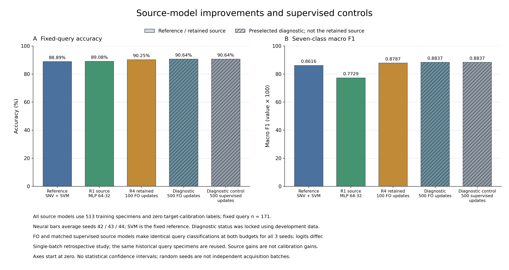
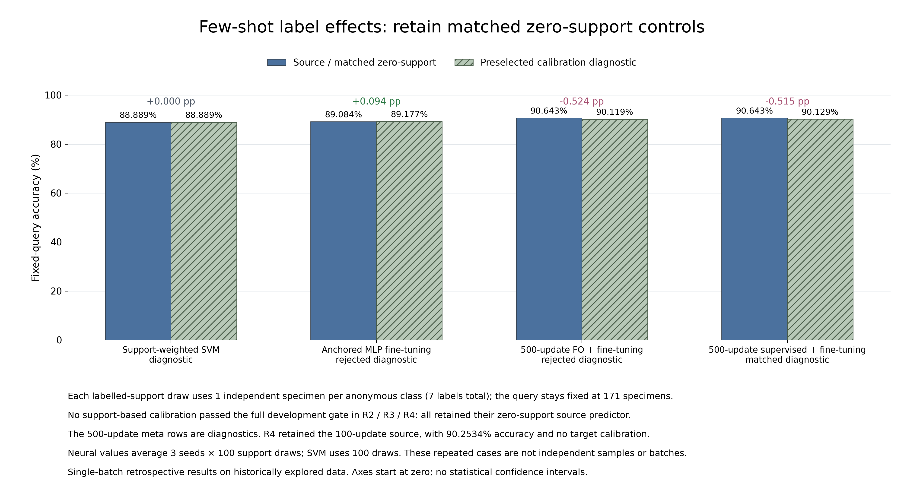

# 酸枣仁后续四轮优化：逐轮结果与结论

2026-10-31。已按用户要求完成四轮实际探索，比较85个主要候选设置及配对控制，保存每次参数、开发指标、固定预测结果和失败情况。**当前正式回退源方案的准确率为90.25%、宏F1为0.8787，高于原SVM的88.89%／0.8616；但该收益来自源模型训练的改善，本轮没有得到通过开发选择的小样本校准方案，也没有证明MAML特有优势。**

所有结果使用同一批真实上传光谱及匿名组ZY01—ZY07。编号、标签、513份训练／171份校准池／171份预测用途均未调整。数据此前已参与研究，每产地只有一批；以下属于同批次回顾性探索，不是新的独立确认或跨批次实验。

## 四轮做了什么，结果如何

| 本次轮次 | 候选设置 | 实际修改 | 固定预测组结果 | 是否采用校准 |
| --- | ---: | --- | --- | --- |
| 1：较强监督MLP | 24 | 源逐频点标准化、PCA维数、64／64–32结构、80／200轮、类别权重 | 锁定MLP平均准确率**89.0838%**，宏F1 **0.7729** | 未使用目标校准标签，属于基础模型结果 |
| 2：加权支持SVM | 21 | 固定源预处理、数值gamma和源类权重，对模型副本加入7份支持样品重新拟合并混合分数 | 原模型、匹配零支持、正式选择和预选家族诊断均为**88.8889%** | 不采用；正式回退原SVM |
| 3：回放／锚定微调 | 24 | 学习率、更新步数、源样品回放权重、参数距离约束 | 正式选择**89.0838%**；预选诊断89.1774%，提高0.0936个百分点 | 不采用；预选诊断未通过开发门槛 |
| 4：重新元训练 | 16 | 从较强MLP出发，100／500个源任务更新、MAML内步长、保守目标微调 | 正式回退100更新源方案：**90.2534%**、宏F1 **0.8787**；预选500更新源诊断90.6433%，校准后降至90.1189% | 不采用；正式结果为零目标支持 |

85是主要格点数，第四轮还为16个目标配置设置了同任务监督继续训练对照，其他轮次也保留零支持控制；它不等于只训练了85个模型。神经网络均报告种子42／43／44的平均值，没有挑最好种子。

### 第一轮：先修复弱神经基础

只读检查上轮保存的监督继续训练权重，其在513份源训练样品上的准确率也只有35.67%／55.17%／65.30%；40轮共同监督初始化最后损失约1.11／1.19／1.09。这个观察提示训练基础值得改进，但保存的权重已经过额外继续训练，不能据此重建初始化准确率，或断言池化是低分原因。[诊断脚本与记录](../reports/multiround-optimization/2026-10-31/previous_neural_source_diagnostic.json)保留输入、权重及源码hash。

本轮24配置在训练组内部选择了`b006_mlp`：逐谱SNV→仅源拟合StandardScaler→64–32双隐层ReLU MLP，200轮、Adam学习率0.001、权重衰减0.001、批量64、无类别权重、无PCA。采用类别加权的其他候选使用实际小批次加权CE语义，未冒称全批次全局加权目标。

| 种子 | 最终正确数／171 | 准确率 |
| --- | ---: | ---: |
| 42 | 153 | 89.4737% |
| 43 | 153 | 89.4737% |
| 44 | 151 | 88.3041% |

均值89.0838%接近原SVM，但宏F1 0.7729、平衡准确率77.6190%均低于SVM的0.8616／86.4286%。ZY02唯一预测样品仅种子44识别正确，平均召回33.33%，因此不能只依据总体准确率增加0.19个百分点就宣布全面胜出。相对旧紧凑ResNet的基础水平提高，是整套输入、结构与训练预算变化后的结果，不能单独归因标准化或某个因素。

### 第二轮：SVM加入7份标签没有改变最终判断

支持样品权重0.25／1／4／16／64，与原／新SVM分数混合0.1／0.25／0.5／1.0，再加不调整，共21配置。源SNV、缩放、C＝10、数值gamma和源类别权重均冻结；重新拟合操作新模型，原源对象保持不变。

30个开发任务、每任务20次支持抽样。没有配置达到开发准确率增益门槛，正式选择不调整。预选家族诊断`w001`使用支持权重0.25、混合0.1，在固定预测组的100次抽样也全部保持152／171正确，未显示额外标签收益。全程3131次参数拟合中，包括31次匹配零支持拟合；这些零支持分数与原源SVM逐项完全相同。

### 第三轮：保守微调的微小诊断收益未被采用

24配置组合全网SGD学习率0.0001／0.001、5／20步、源回放权重0／1／4、参数锚定系数0／0.1。目标损失包括7份支持CE，源回放使用全源CE，参数约束为相对保存源权重的平方距离和。匹配零支持对照保留相同源回放、步数及约束，只去掉目标支持损失。

全部候选未通过开发门槛，正式保持源MLP。预选诊断`a000`（学习率0.0001、5步、无回放／锚定）在最终平均提高0.0936个百分点，300种情景中54次提高、240次不变、6次下降。收益只涉及ZY03-065、ZY03-031、ZY07-071三个独立编号，另伤害ZY06-071和ZY07-042。原始改对／改错记录均保留，不能根据这一最终小增益倒推采用配置。

### 第四轮：更充分源训练有帮助，MAML特有收益未观察到

四种源设置为100／500次更新×MAML内步长0.001／0.01。每个设置从相同MLP初始化复制，FO-MAML与监督继续训练共享相同3类源任务、支持／查询编号、额外更新次数及全源监督约束。实际使用一阶梯度，不是完整二阶MAML；两策略计算量并未作FLOPs匹配。

| 来源与目标适配 | 准确率 | 宏F1 | 解释 |
| --- | ---: | ---: | --- |
| 原较强MLP，不用目标支持 | 89.0838% | 0.7729 | 第一轮起点 |
| 100更新FO源模型／正式回退 | **90.2534%** | **0.8787** | 预先指定的正式零支持回退 |
| 同100更新监督继续训练，不用目标支持 | **90.2534%** | **0.8787** | 与FO逐种子、逐样品分类结果相同 |
| 500更新FO源模型／预选诊断 | 90.6433% | 0.8837 | 诊断来源，不根据最终高分替换正式方案 |
| 同500更新监督继续训练，不用目标支持 | 90.6433% | 0.8837 | 与同设置FO分类结果相同 |
| 500更新FO＋预选7样品校准 | 90.1189% | 0.8770 | 比自身源模型下降0.5244个百分点 |
| 500更新监督＋对应7样品校准 | 90.1287% | 0.8771 | 比自身源模型下降0.5146个百分点 |

配对源控制不是只看均值相等：每个种子的171个预测标签均相同，权重和原始分数则不同。此补充只读推理使用已保存、预先定义的配对模型，没有新增拟合或模型选择，完整2565条结果见[源对照诊断](../reports/multiround-optimization/2026-10-31/meta-refinement/source_control_diagnostic.json)。因此，本轮不能声称“MAML特有机制提高了准确率”；更直接的解释是额外源监督训练已足以取得同样分类结果。

FO预选校准诊断300种情景中68次提高、94次不变、138次下降。第四轮正式90.25%来自**零目标支持源模型**，不能写成“7样本校准达到90.25%”。此外，ZY02在100更新源模型中的唯一预测样品虽被三个种子识别正确，样品数仍只有1，不能据此证明该组可靠泛化。

## 本轮如何防止追着预测分数优化

四轮均先完成训练组内部开发选择和检验。第一、三、四轮用6个任务、前4选／后2检验和三个种子；第二轮用30个任务、前24选／后6检验。目标校准候选必须同时优于原源模型及匹配零支持控制，准确率增益超过0.1个百分点，宏F1和平衡准确率下降均不超过0.5个百分点，不满足则回退。

所有四份选择锁、协议、运行清单在统一放行记录[all_development_locks.json](../reports/multiround-optimization/2026-10-31/all_development_locks.json)中保存hash。写入时四轮均无最终输出目录，之后才统一评分原171份预测样品。后续轮次只依赖第一轮的开发选择，没有用其最终分数设计格点。原始源对象与预处理器保存，适配操作副本；最终标签只在评分边界按编号连接。

时序证据有强弱之分：轮2—4保留实际最终开始UTC；轮1未另存独立最终开始UTC，其阶段顺序依据放行时无最终目录及选择锁／源码hash记录。记录与指纹核验不等于外部执行认证，未补造时间戳。

每产地1份、共7份支持样品，100次支持抽样；ZY02校准池只有1份，不能做七类3／5-shot。三种子×100次抽样是重叠情景，不是300个独立批次。重复源开发任务同样不产生新的独立样品。

## 每次结果在哪里

优先查看[四轮优化完整Excel](../reports/multiround-optimization/2026-10-31/tables/四轮优化_完整结果与样品预测对照.xlsx)。包含四轮台账、全部候选开发汇总、全部最终方法及控制、各种子、逐产地、随机预测与逐样品统计，并补入配对源模型诊断。错误和没有提高的候选没有删除。

| 轮次 | 开发评价数 | 最终评价数 | 开发逐样品预测 | 最终逐样品预测 |
| --- | ---: | ---: | ---: | ---: |
| 1 | 432 | 3 | 44,496 | 513 |
| 2 | 12,600 | 400 | 1,297,800 | 68,400 |
| 3 | 2,160 | 1,500 | 268,830 | 256,500 |
| 4 | 2,880 | 2,700 | 296,640 | 461,700 |
| 合计 | **18,072** | **4,603** | **1,907,766** | **787,113** |

主要运行共2,694,879条预测记录，另有2565条只读配对源诊断；这些是重复评价记录，独立样品仍为原855份。208项项目测试通过。独立审计从原始预测重算指标、选择门槛、配对改对／改错和模型／输入hash，并检查源任务清单及统一放行时序；详见[审计JSON](../reports/multiround-optimization/2026-10-31/independent_audit.json)。

真实执行时间分别约176.54秒（轮1）、56.46秒开发＋4.87秒最终（轮2）、34.53＋4.35秒（轮3）、140.74＋22.37秒（轮4），不含编码和复核时间。各轮有并行执行，不能相加当作总墙钟耗时或方法速度排名。第四轮原始最终执行状态单独保存，续跑检查耗时没有冒充训练耗时。

完整证据及可还原开发记录见[报告目录](../reports/multiround-optimization/2026-10-31/README.md)，可读取权重和预处理器见[模型目录](../models/multiround_20261031/README.md)。非入选开发权重缓存保留本地，GitHub保存全候选指标、原始预测、hash、生产脚本和入选／最终权重，避免把数千个缓存文件混入代码审阅。

## 后续取舍

当前应保留SVM作传统参照，并把“标准化后的MLP＋充分源监督训练”作为值得继续验证的识别路径。90.25%与SVM88.89%的差异发生在同一个已曝光预测组；尚不足以宣布普遍优越。500更新源对照90.64%为预选诊断，不能事后替换正式结果。

小样本部分目前能诚实报告的是：弱神经起点曾有自身校准增益，但提高基础水平后，本轮支持标签尚无通过开发流程的额外收益。继续研究应优先在训练内部检验源训练预算、类别平衡和稀少类稳定性，并用新采集的各产地独立样品确认；要研究真实跨批次校准，需要同一组产地对应的新批次支持／预测样品。当前不加入Gaussian，不把已有MLP、SVM或MAML改名当作原创算法，也不把人工增加重复记录当作增加样本量。
