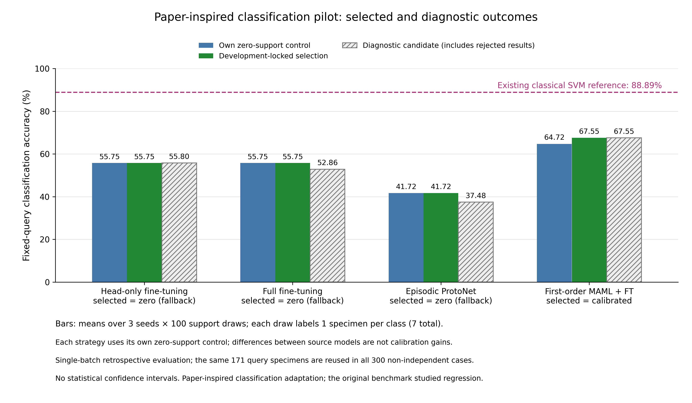
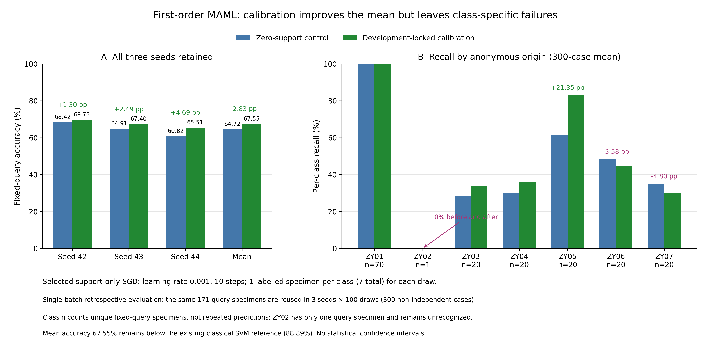

# 少样本光谱论文方法借鉴：酸枣仁分类实测报告

2026-10-31。已重新核对原论文全文、作者固定代码快照，并实际运行分类适配。**一阶MAML的小样本校准从自身64.72%提高到67.55%，增加2.83个百分点；三个训练种子的平均增益均为正。但它仍低于同一预测组上现有SVM的88.89%，目前不能替代SVM主模型。**

这里使用用户上传的真实光谱和匿名产地组ZY01—ZY07，匿名的是地名。没有生成模拟光谱。每产地只有一批，且当前预测样品曾参与历史研究；本轮属于同批次回顾性探索，不能视作独立新批次确认。

## 原论文哪些方法可以借鉴

Garzón等，*A task-oriented few-shot spectroscopy benchmark: Empirical evaluation of meta-learning approaches*，EAAI 167（2026）113593。[原文PDF](../references/research-literature/fewshot-benchmark-2026/1-s2.0-S0952197625036255-main.pdf)，[DOI](https://doi.org/10.1016/j.engappai.2025.113593)。

| 原文内容及位置 | 本课题实际采用的方式 | 适用边界 |
| --- | --- | --- |
| §3.2、§3.5，PDF第4—5页：光谱预处理、共享ResNet1D、连续属性回归 | 共享紧凑ResNet1D提取光谱特征，输出7类产地 | 原文是NIR／MIR回归，本轮是THz分类；不能照搬回归损失和指标 |
| 第5页：fine-tuning | 分开测试只微调分类头、全网络微调 | 原文FT包括网络适配；只调分类头是另设对照 |
| 第5页：MAML | 实现真正的一阶MAML源元训练，再用7份目标支持样品微调 | 未实现完整二阶MAML；不冒称原论文参数复现 |
| 第5页：Prototypical Networks | 源任务中学习分类原型距离，再测试源／目标原型混合 | 原文连续值距离加权回归已改为类别原型分类 |
| Table 4：5／10／25-shot | 当前每类1份，共7份目标支持样品 | 原文shot是每任务总数；本轮每类1份不是原文1-shot回归 |
| §4.6、Fig.6，第8页：噪声、增益和漂移扰动 | 本轮没有将人工扰动当作真实新批次 | 原文这部分也不是实际更换仪器后的验证 |

原文精确结构与超参数网格主要指向未上传的附录B。核查作者公开固定快照`13771327980ba904641dcdec3037822d4baec34f`，训练脚本导入`models.cnn.ResNet1D`，但该快照缺少对应`cnn.py`。因此本轮借鉴的是学习与评价框架，**不是逐项复现原文的网络或结果**。SNAIL和SimCLR未在本轮实现。逐页证据及代码审读见[独立审读记录](../reports/paper-fewshot-classification/2026-10-31/paper-fewshot-pilot-review-20261031.json)。

## 数据、学习与选择如何隔离

沿用已经固定的513份训练、171份校准池、171份预测划分，编号和标签不变。主分析使用频率坐标0.1—1.5范围内的612个吸收系数特征；这是先定的工程候选区间，未将其宣布为物理最优频段。ZY02全体仅5份，三个角色分别3／1／1份，因此七类校准只能每类1份。

只在原513份训练组内部构造6个开发任务，每个307份源训练、103份支持池、103份开发预测；前4个选择配置，后2个检验，三个种子共同决定选择。开发每任务5次支持抽样。31个候选和门槛先固定，选择锁写入后才评价原171份预测样品。准确率增益需超过0.1个百分点，宏F1和平衡准确率的下降均不得超过0.5个百分点，否则采用自身零支持模型。

每个源元任务为3类，每类1份源支持、1份源查询，共6份不同独立样品。开发阶段ZY02源训练只有1份，无法同时提供源支持和源查询，故不进入这部分元任务，但保留在七类监督初始化和全部七类目标评价。最终513份源训练中ZY02有3份，七类均可进入源元任务。JSON字段`labels_not_shared_between_source_and_target_roles`指的是**样品及其标签记录互斥**；各角色的类别词表仍相同。

共同骨干采用16／32通道残差卷积、GroupNorm、8段池化及32维表示。输入使用逐谱SNV，不利用待预测批次统计量。每个种子先监督训练40轮，再从同一初始化出发，在相同100组源任务编号上分别继续监督训练、分类ProtoNet训练和一阶MAML训练。额外外层更新次数相同，计算量和耗时未作等量匹配；ProtoNet用局部3类原型，监督与MAML保留7类头，优化目标也不同。

源任务的查询标签可以用于元训练；原171份目标预测标签只用于评分。目标微调使用模型副本，不覆盖保存的源权重。ProtoNet与同一编码器的零支持源中心比较，MAML与自身零支持头比较，避免把换编码器／换分类头的收益算作校准收益。

## 完整实测：保留未通过和下降的方法

以下为种子42／43／44各100次支持抽样的平均值。每次校准每类1份，共7份，固定预测171份。三个种子与重复支持抽样构成300种计算情景，**不是300组独立实验样品或批次**。

| 方法 | 自身零支持准确率 | 开发阶段预选候选的最终诊断准确率 | 差值（百分点） | 按先定规则实际采用 |
| --- | ---: | ---: | ---: | --- |
| 监督ResNet，只调分类头 | 55.7505% | 55.8031% | +0.0526 | 未通过开发门槛，保留55.7505% |
| 监督ResNet，全网微调 | 55.7505% | 52.8635% | −2.8869 | 未通过开发门槛，保留55.7505% |
| 分类ProtoNet，目标原型 | 41.7154% | 37.4795% | −4.2359 | 未通过开发门槛，保留41.7154% |
| 一阶MAML＋全网微调 | 64.7173% | **67.5458%** | **+2.8285** | 通过开发选择与检验，采用校准 |
| 现有SNV＋SVM，传统对照 | **88.8889%** | 本表不计其校准 | — | 仍是本轮主频段绝对准确率更好的模型 |

前三行诊断候选同样由开发数据预选，并非从最终预测结果挑出的最好配置。正式选择中的回退结果和失败候选均保留在[12行汇总](../reports/paper-fewshot-classification/2026-10-31/summary.json)。SVM为同一固定预测组上的152／171份正确，神经网络数值为多个训练种子和支持抽样的均值，二者不能混称单个冻结模型的准确率。

一阶MAML被选中的是`n023_fomaml_ft`：目标校准学习率0.001、全网10步。宏F1由0.3922提高到0.4338，平衡准确率由43.3333%提高到46.7915%。三个种子的情况如下：

| 训练种子 | 校准前准确率 | 校准后平均准确率 | 提高（百分点） |
| --- | ---: | ---: | ---: |
| 42 | 68.4211% | 69.7251% | +1.3041 |
| 43 | 64.9123% | 67.4035% | +2.4912 |
| 44 | 60.8187% | 65.5088% | +4.6901 |

300种情景中258次提高、16次不变、26次下降。每次平均纠正11.4133份样品，同时引入6.5767份新错误，净增加约4.8367份正确预测。校准有总体收益，但不保证任意一次抽样都提高。

| 匿名组 | 固定预测样品数 | MAML校准前平均召回率 | 校准后平均召回率 |
| --- | ---: | ---: | ---: |
| ZY01 | 70 | 100.0000% | 99.9905% |
| ZY02 | 1 | **0%** | **0%** |
| ZY03 | 20 | 28.3333% | 33.5833% |
| ZY04 | 20 | 30.0000% | 36.0000% |
| ZY05 | 20 | 61.6667% | 83.0167% |
| ZY06 | 20 | 48.3333% | 44.7500% |
| ZY07 | 20 | 35.0000% | 30.2000% |

ZY05改善较大，ZY06、ZY07下降，极少数ZY02样品没有识别成功。因此不能写成“七个产地均得到改善”，也不能仅靠总体准确率宣称七类可靠识别。





## 对论文主线的决定

**保留老师算法中的SVM为主要识别基准，将一阶MAML作为已经出现正向校准收益的探索对照。** 本轮证明“学习初始化后，用少量带标签样品适配”可以在当前实现上改善自身预测；尚未证明它能胜过现有主模型。其他方法的负结果提供了必要对照，不能删去后只呈现有利的方法。

下一阶段应先提高并稳定神经网络的零支持基础水平，再在训练内部研究预处理、训练预算和类别平衡，而不是继续把低起点上的相对提升包装成整体最优。任何后续配置都应另立协议，保持本轮原始预测和选择锁。独立确认需要新采集的各产地样品，尤其补充ZY02；若要主张跨批次小样本校准，应在各产地覆盖相应独立新批次，预先固定支持和预测角色。

这只是紧凑CPU网络和固定预算下的试验，SNV、网络结构及目标任务均与原文不同；不能由此推断原论文的MAML或ProtoNet在其他光谱数据上一定有效或无效。重复使用当前171份预测只能作为探索，不能通过不断重试制造独立确认。

## 可检查的交付与复核

- [Excel：论文方法试验、预测与标签对照](../reports/paper-fewshot-classification/2026-10-31/论文方法试验_预测与标签对照.xlsx)：7张表，含全部策略、三个种子、逐产地、720条预先随机展示记录、513条MAML逐样品汇总；保留错误标记。
- [完整证据目录](../reports/paper-fewshot-classification/2026-10-31/README.md)：31候选、2790次开发评价、3600次最终评价、615600条逐样品预测。随机展示720条中311条错误全部保留。
- [源模型权重与读取说明](../models/paper_fewshot_20261031/README.md)：保存63份源权重；18个开发上下文、3个最终种子上下文各3种策略；共同初始化只保存指纹，没有另存权重。
- [先行协议](PAPER_NEURAL_CLASSIFICATION_PROTOCOL.md)与[机器协议](../data/research/paper_neural_classification_protocol_20261031.json)。
- [并行传统算法／潜空间优化报告](REPRESENTATION_AND_LATENT_REPORT.md)：54个源管线及60种潜空间适配，区分表征改善与标签校准收益。

实际CPU训练及评价约168.6秒，时间只是本云端执行记录，不作方法间速度排名。172项项目测试通过；独立数值审计重新检查615600条预测、3600组指标、6300条源任务清单、权重hash、选择锁及样品隔离关系，未发现不一致。标签检查确认编号、匿名组、预测真值及正确标记一致，**不等于外部核实真实地名或物种**。

复跑入口如下；在原运行目录使用`--resume`只验证已完成结果，在新目录会重新执行。依赖与原始数据准备见[统一安装说明](INSTALL_AND_RUN.md)。

```bash
OMP_NUM_THREADS=1 OPENBLAS_NUM_THREADS=1 MKL_NUM_THREADS=1 PYTHONPATH=src \
  .runtime/bin/python scripts/run_paper_fewshot_pilot.py \
  --input outputs/approved-zaoren-20261031/data-preparation/dataset.npz \
  --split-plan data/processed/zaoren_threeway_20261031_v1/split_plan.json \
  --protocol data/research/paper_neural_classification_protocol_20261031.json \
  --output outputs/paper-fewshot-pilot-20261031 --resume
```
