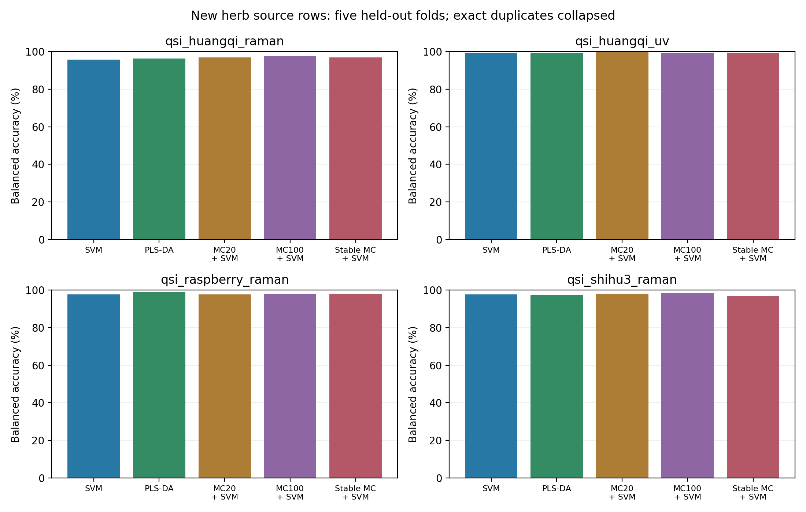
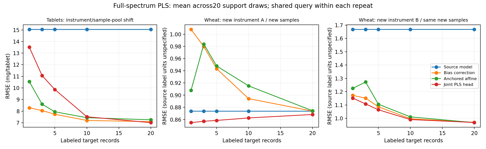

# 后续科研阶段二：数据扩展、变量筛选与少样本校准

日期：2026-10-30（北京时间）。本阶段已完成来源检索、代码实现、数据审计和真实运行。

完成 **200个分类模型/外层折场景、7200组校准评价、74项单元测试**。7200包含同一源模型在不同support抽取、样本量和方法上的评价，不是7200个独立研究或7200次源模型训练。正式校准结果只计`*_final`，元数据措辞修正前的运行不重复计数。

## 结论与研究决定

继续保留SVM/PLS-DA与普通MC-UVE作为主要基线，CARS-style作为筛选对照。重复筛选聚合没有在四种药材表示上表现出一致增益，暂不将其定为论文最终改进。少样本校准对药片和小麦B的明显偏移有帮助，对小麦A未必有收益。

下一步问题应聚焦：**如何在不接触最终query的条件下，判断是否需要校准、选择校准强度并保持变量模型有效。** 后续规则仍须在训练内或仅support中选择，最终由封存的新药材批次验证。当前数据已被研究者观察，继续使用时属于探索性分析。

## 数据扩展与边界

本轮登记34条来源/表示记录：24条药材相关、10条迁移候选。不是34个独立队列，也不是全部已下载。11条药材表示已在本地读取；不同模态、同队列、既有材料、仅元数据和访问受限分别标记，见[数据目录](RESEARCH_DATASET_CATALOG.md)及[机器可读检索表](../data/external/research_stage2_catalog.csv)。

新增分类实测采用作者[qsi-tk1.4.1](https://pypi.org/project/qsi-tk/1.4.1/)中的CSV/文本。仅以ZIP读取数据，不安装或执行包代码/字节码；wheel和成员SHA已核验。原谱、wheel、RDA和工作簿留在忽略的outputs目录，仓库保存下载器与来源/hash。

| 表示 | 原谱行→精确去重后 | 点数 | 标签与限制 |
| --- | ---: | ---: | --- |
| 黄芪Raman | 160→160 | 2090 | 四产地，缺物理样品/批次映射 |
| 黄芪UV | 160→160 | 601 | 与Raman同一源队列，不能算第二独立队列 |
| 源标注Raspberry Raman | 250→249 | 1682 | 五产地；源写Rubus idaeus，未核验药典物种 |
| 源标注Shihu3 Raman | 200→195 | 1681 | 三产地整数标签，未找到完整整数至产地映射 |

折叠同标签精确重复谱，冲突标签会拒绝。缺少近重复扫描/物理样品/批次ID，所以这些是**源谱行级五折基准**。精确去重不能证明不同谱来自独立药材。外部Raman/UV高分不能直接代表用户自有黄芪太赫兹性能。

另已核验黄芪AMM含量数据：720叶行来自15植株，三目标单位mg/g且植株内标签重复，应按15植株分组；本轮未将720行作为独立样品建模。芒果跨季数据已下载，但有重复扫描、多温测量而缺fruitID，暂不把谱行当作K个独立果实做校准。

## 新模块与既有方法关系

- `StableVariableSelector`：训练重采样并聚合MC-UVE/CARS-style选择，固定最终点数，记录入选频率和Jaccard。有groups时先按物理样品聚合；没有groups时不能恢复未知重复关系。
- `ShrinkageAffineCalibrator`：仅由目标support估计偏差/斜率，向源预测恒等映射收缩；单样本或常量预测退为偏差校准。
- `AnchorScoreCalibrator`：分类分数的源锚定ridge校正，显式保留源类别顺序。已通过单元测试；**本轮尚未有真实药材域标签的分类校准实测**。

这些是既有思想的工程候选。[Han等2008 EMCUVE投票筛选](https://doi.org/10.1016/j.aca.2008.02.032)和[Zhang等2022 SAFS与校准传递](https://doi.org/10.3390/s22041659)已研究相关方向；[8篇方法登记](../data/research/stage2_prior_art.json)保留主来源和查阅范围。重采样频率不是p值，也不自动具有FDR控制，本轮尚未建立方法新颖性。

## 分类消融协议与结果

先精确去重，再固定分层五折seed20261030，模型seed42。每个外层训练区内三折选择原谱/SNV及模型参数，预处理、缩放、选择器、分类器完整Pipeline重新拟合；外层test仅评价。原谱轴和数值保留，不补造通道。

SVC的C为0.1/1/10/100、gamma=scale；PLS-DA使用one-hot PLS后argmax，潜变量1/2/3/5/8按维度裁剪。CARS-style＋PLS-DA仅1/2潜变量，因此不能声称所有方法搜索网格完全相同。

比较全谱、CARS-style12轮、MC20、MC100和重复MC共五种表示，分别接SVM/PLS-DA，共10条路径。MC20/100/重复MC均保留ceil(10%谱点)，最终维度匹配。重复MC为10次外重采样×10次内MC，另有10次系数拟合破同频平局；MC100是额外工作量对照，非所有计算步骤严格相同。

下表为五折测试预测拼接后的准确率（%）；全部路径的balanced accuracy、macro-F1、precision/recall、MCC、点数和耗时见[总体指标CSV](../reports/research-stage2/2026-10-30/classification_pooled.csv)。

| 表示 | 全谱SVM | 全谱PLS-DA | MC20＋SVM | MC100＋SVM | 重复MC＋SVM |
| --- | ---: | ---: | ---: | ---: | ---: |
| 黄芪Raman | 95.625 | 96.250 | 96.875 | 97.500 | 96.875 |
| 黄芪UV | 99.375 | 99.375 | 100.000 | 99.375 | 99.375 |
| Raspberry Raman | 97.590 | 98.795 | 97.590 | 97.992 | 97.992 |
| Shihu3 Raman | 97.436 | 97.436 | 97.949 | 98.462 | 97.436 |



黄芪Raman的MC方法均保留209点；UV保留61点。重复聚合没有一致超过普通MC或MC100。若干差距仅对应少量谱，不能认定统计显著或跨批次更稳定。没有根据test重选预算、划分或删去不利结果；训练入选频率/Jaccard只作为重采样诊断。

## 少样本迁移协议

| 设置 | 源区 | 目标池 | 每次固定query | 目标单位 |
| --- | --- | --- | ---: | --- |
| 药片 | 仪器1原Train＋Validate195记录 | 仪器2原Test460记录 | 440 | assay，mg/tablet |
| 小麦A | A1.CAL248原样品 | vliadA150新样品/新仪器A | 130 | 原文档未明确单位 |
| 小麦B | 同248源样品 | vliadB同150新样品/另一新仪器B | 130 | 同上，不是第二独立目标队列 |

小麦[作者文档](https://github.com/HMzhu/CTVPdtw/blob/dad77175e6148ce587d49f2f1979a7d6de3271c7/man/wheat.Rd)明确另150新样品在新仪器上测量，没有将同一248样品的不同设备谱当独立query。源/目标ID由作者群体说明和记录位置恢复，不是原始实物编号；药片另按两仪器参考字段与行顺序核验配对。记录与精确谱隔离已确认，但不能扩大为所有采样关系均独立验证。

源模型有全谱、MC20、MC100、重复MC四种表示，用source-only三折选择原谱/SNV和PLS潜变量。每次随机重复先预留20条目标记录作为support pool，其余为固定query；support取前1/3/5/10/20，嵌套且所有表示/方法共用query。K=1时其余19条预留记录不进入query。20次重复；回归K是有标签记录总数，不是每类K条。

比较不校准、无收缩偏差、无收缩斜率/偏差、λ=1收缩斜率/偏差、support-only PLS头、源＋support PLS头六种方法。后两者冻结源预处理/缩放/选点表示，仅重拟合PLS头，**不是完整target-only或完整Pipeline联合重训**。单条support使用均值；joint头仍使用源数据，按总训练行数裁剪潜变量，未人为弱化。

每设置4表示×20重复×5样本量×6方法=2400评价。参数不由query选择。重叠query上的重复SD是描述性变化，不是独立研究的置信区间；小麦A/B目标ID、真值和support/query抽取完全相同。

以下为20条support时20次重复的平均RMSE；只在同一设置/单位内比较。全部样本量、六方法、MAE、R²、bias、RPD及配对差见[迁移汇总](../reports/research-stage2/2026-10-30/transfer_summary.json)。

| 设置 | 源表示 | 不校准 | 偏差校准 | 收缩斜率/偏差 | 源＋support的PLS头 |
| --- | --- | ---: | ---: | ---: | ---: |
| 药片 | 全谱 | 15.0467 | 7.0881 | 7.2508 | 7.0064 |
| 药片 | MC20 | 4.7169 | 4.7995 | 4.8571 | 4.5062 |
| 药片 | MC100 | 5.4624 | 5.4628 | 5.5534 | 4.6955 |
| 药片 | 重复MC | 8.7035 | 5.2787 | 5.3810 | 4.6199 |
| 小麦A | 全谱 | 0.8737 | 0.8738 | 0.8743 | 0.8682 |
| 小麦A | MC20 | 1.7272 | 1.1436 | 1.1350 | 1.5021 |
| 小麦A | MC100 | 1.3106 | 1.2501 | 1.2591 | 1.2565 |
| 小麦A | 重复MC | 0.9271 | 0.9369 | 0.9611 | 0.9181 |
| 小麦B | 全谱 | 1.6678 | 0.9698 | 0.9676 | 0.9686 |
| 小麦B | MC20 | 5.2453 | 1.6157 | 1.3306 | 1.7933 |
| 小麦B | MC100 | 4.5133 | 1.4885 | 1.3379 | 1.7532 |
| 小麦B | 重复MC | 1.5060 | 1.1208 | 1.1227 | 1.1028 |



药片全谱偏差校准改善明显，但普通MC20本身更好；重复MC校准后也没有超过MC20＋joint头。小麦A全谱模型已较稳，收缩校准略差；小麦B全谱收缩校准明显降低误差。结果不支持统一宣称稳定筛选或校准总能获益，也不能根据query挑最佳组合后再当作未见测试成绩。

## 下一阶段的执行条件

1. 保留全部正负结果，以普通基线为参照。比较仅support选择校准规则、训练内模拟域选择及预固定规则，后续改进仍另设确认数据，不能反复在当前query上寻优。
2. 自有黄芪先补齐真实产地、样品/压片编号、重复扫描、批次和日期。每产地只有一批时，无法区分产地与批次效应。
3. 成分定量需要逐样品对应的标准化学值；AMM15植株候选也必须整植株分组，不能替代自有样品HPLC/UPLC参考。
4. [本地阶段配置](../data/research/stage2_experiment_plan.json)记录本轮规则，不是公开预注册。真实药材分类跨批次校准及新颖性仍未完成。

## 复现与证据

在仓库根目录使用新的输出目录；程序拒绝覆盖已有非空输出：

```bash
python scripts/setup_research_environment.py
.runtime/bin/python scripts/prepare_stage2_herb_benchmarks.py --download --output outputs/stage2-herb-inputs-new
.runtime/bin/python scripts/run_stability_research.py --spec outputs/stage2-herb-inputs-new/spec.json --output outputs/stage2-classification-new
.runtime/bin/python scripts/prepare_transfer_benchmark.py --download --output outputs/stage2-pharma-input-new
.runtime/bin/python scripts/run_transfer_research.py --input outputs/stage2-pharma-input-new/transfer_input.npz --metadata outputs/stage2-pharma-input-new/source_registry.json --output outputs/stage2-pharma-results-new
```

小麦RDA通过隔离解析库重建，不运行R代码：

```bash
.runtime/bin/python -m pip install --target outputs/wheat-parser -r environment/requirements-rda.lock.txt
.runtime/bin/python scripts/prepare_wheat_transfer.py --download --parser-path outputs/wheat-parser --output outputs/stage2-wheat-input-new
.runtime/bin/python scripts/run_transfer_research.py --input outputs/stage2-wheat-input-new/transfer_input.npz --metadata outputs/stage2-wheat-input-new/source_registry.json --output outputs/stage2-wheatA-results-new
.runtime/bin/python scripts/run_transfer_research.py --input outputs/stage2-wheat-input-new/transfer_B_input.npz --metadata outputs/stage2-wheat-input-new/source_registry.json --output outputs/stage2-wheatB-results-new
```

可选汇总器`summarize_stage2_research.py`参数见`--help`；本次绘图Matplotlib3.10.8，训练不依赖绘图库。来源/输入/代码hash、分类逐条预测/混淆矩阵、校准全部预测NPZ、分区及独立复算记录见[阶段证据](../reports/research-stage2/2026-10-30/stage_summary.json)。大JSON无损压缩为.json.gz，原hash在compressed_artifacts.json，归档hash在files_sha256.json。

分类runner曾仅修正网格比较范围的描述，算法、参数、预测未改；执行时旧源码快照、修正前结果与修正记录一并保留，旧执行hash仍有对应文件。
