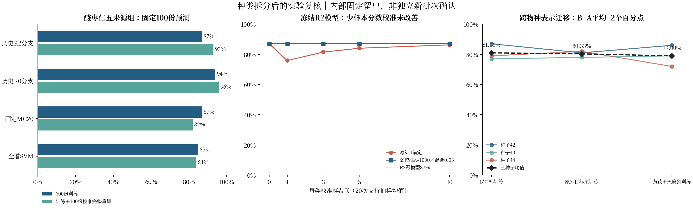

# 区分枣仁与酸枣仁后的识别、校准和跨物种迁移结果

2026-11-08（Asia/Shanghai）。数据版本 `2026-11-08-confirmed-origin-kind-v1`。本次接续既有算法和固定留出名单，完成6项分类任务及3种子跨物种迁移对照。

## 可以区分种类，纯酸枣仁来源识别仍有效；少样本校准和跨物种正迁移尚未成立

枣仁／酸枣仁二分类在固定174份预测样品上174份全部正确。纯酸枣仁五来源组中，沿用历史R2搜索流程、只在300份训练样品内选参后正确87/100；将校准池100份加入完整Pipeline重训后为93/100。这说明标签纠正后仍存在可识别信号，但后者使用400份目标标签，不能解释为1—10份／类的冻结模型校准已经有效。[1–3]

黄芪＋天麻预训练后再用300份酸枣仁微调，三种子平均为79.00%；仅目标训练为81.00%，等额额外目标预训练为80.33%。当前协议没有显示正迁移。旧强锚定校准继续降低表现，弱校准大体保持原分数，不能以复杂度或模型名称替代增益证据。[3–4]

所有结果属于样品互斥的内部留出验证。原855份已参加历史多轮开发，原ZY每来源只有一个用户声明批次；当前没有独立新批次确认。用户确认的中文种类标签也不等于独立植物学鉴定。[1]



## 原来的实验可以怎样保留

原七类是ZY01—ZY07来源组，现确认ZY01、ZY02为枣仁，其余五组为酸枣仁。历史R2七分类821/855＝96.02%必须改称混合种类的来源组识别，不能继续称纯酸枣仁产地鉴别。[2]

独立重算旧OOF后，R2按种类折叠为852/855＝99.65%。原七分类在酸枣仁500条子集内的正确数由R0的428增加到R2的470，贡献全部48个新增正确中的42个。因此，标签问题影响任务定义和论文结论，现有证据没有表明前期算法改进全部无效。这些数值只是旧预测的回顾性拆解，不是新训练的二分类或五分类成绩。[2]

本次直接复用17个历史源码模块，逐文件Git blob与研究提交 `3fc996e99cce8ff5799b5a2af9b565f982dfc899` 完全相同。R0的8候选、R2先36个MC配置再96个SVM配置、训练内宏F1优先规则，以及原编码器、SNV和锚定实现均被保留。修改的是任务、类别数、输入入口和评价边界。[1,3–4]

## 固定划分已经逐样品保存

原855份的训练／校准／预测角色全部继承历史名单，没有重新洗牌。新增817份按相同约60%／20%／20%补齐。每份样品只有一个角色，所有任务共享主名单。[1]

| 种类 | 训练 | 校准池 | 预测 | 合计 |
| --- | ---: | ---: | ---: | ---: |
| 酸枣仁 | 300 | 100 | 100 | 500 |
| 枣仁 | 216 | 74 | 74 | 364 |
| 黄芪 | 241 | 80 | 82 | 403 |
| 天麻 | 242 | 80 | 83 | 405 |
| 总计 | 999 | 334 | 339 | 1672 |

独立性依据是用户明确声明“每列都是独立实物样品”，未由此补造批次。α／n逐列配对、18份当前文件hash、有限值和单调坐标检查全部通过，未发现精确重复谱；另一读取器40个源单元格抽查全部一致。主区间0.1—1.5保留612个原始频点，不做插值；迁移沿用128点0.21—1.49网格，无外推。[1]

## 六项分类结果必须同时看准确率和少数类表现

下表二分类和酸枣仁行使用历史R2分支，其他行为预先固定参数的全谱SVM。表中完整重训重新拟合预处理、筛选和模型，参数保持训练内锁定值；它不是冻结模型分数校准。[3]

| 任务 | 源模型正确数／预测数 | 准确率 | 宏F1 | 平衡准确率 | 加入全部校准池完整重训 |
| --- | ---: | ---: | ---: | ---: | ---: |
| 枣仁／酸枣仁二分类 | 174/174 | 100.00% | 1.0000 | 100.00% | 174/174 |
| 酸枣仁五来源组（R2） | 87/100 | 87.00% | 0.8693 | 87.00% | 93/100 |
| 四种药材识别 | 331/339 | 97.64% | 0.9751 | 97.50% | 330/339 |
| 黄芪四来源组 | 69/82 | 84.15% | 0.8386 | 84.09% | 69/82 |
| 天麻四来源组 | 81/83 | 97.59% | 0.9756 | 97.62% | 82/83 |
| 枣仁五来源组诊断 | 72/74 | 97.30% | 0.5972 | 60.00% | 72/74 |

**枣仁产地结果不能称可靠。** 预测组74份中陕西延安占70份，只预测延安就有70/74＝94.59%。辽宁、内蒙古新增枣仁各只有1份预测且均判错，两个来源召回为0；每组总数只有3份，训练／校准／预测各1份，无法支撑正常调参或稳定的类别准确率。应优先补足云南及三个新增枣仁来源的独立样品和新批次。[3]

纯酸枣仁没有因拆分而丢失样本平衡：五来源各100份，固定预测各20份。R2源模型各来源召回为内蒙古75%、山西灵石95%、安徽亳州90%、河北石家庄80%、山西95%；完整重训后为85%、95%、95%、95%、95%。仍需针对内蒙古来源的错误核查采集与制样条件。[3]

### 所有酸枣仁分支都保留，不能事后只选96%

| 历史算法分支 | 仅训练300份 | 加入100份校准池完整重训 |
| --- | ---: | ---: |
| 固定全谱SVM | 85/100 | 84/100 |
| 固定MC20＋SVM | 87/100 | 82/100 |
| R0训练内重新选参 | 94/100 | 96/100 |
| R2训练内重新选参 | 87/100 | 93/100 |

R2训练内两折宏F1为0.8900，R0为0.8432；本次固定预测上R0反而更好。不能看完预测后把R0替换成“预先选定的最佳模型”，或保证历史R2总会优于R0。该反转提示样本划分与选参存在不确定性，需独立新批次验证，不能据此继续调整已曝光预测集。[3]

## 冻结模型的少样本校准没有稳定增益

酸枣仁R2的固定100份预测组，在每类K份支持、20次嵌套支持抽样下得到如下均值。所有支持来自专用校准池；增加重复次数没有增加独立预测样品数。[3]

| 每类支持K | 源模型 | 原λ=1锚定 | 弱校准λ=1000／混合0.05 |
| --- | ---: | ---: | ---: |
| 1 | 87.00% | 75.90% | 87.00% |
| 3 | 87.00% | 81.50% | 87.00% |
| 5 | 87.00% | 84.05% | 87.00% |
| 10 | 87.00% | 86.30% | 87.00% |

完整重训的87%→93%来自额外100个目标标签、全部变换重新拟合，不是这个表里的K-shot分数校正。常规SVC投票与OVR分数argmax另设匹配零支持对照；例如四类固定MC20弱校准比源投票多对1份，但零校准argmax已经多对同一份，不能算校准贡献。[3]

## 跨物种框架能运行，当前证据不支持正迁移

只用黄芪241份、天麻242份训练角色做辅助预训练，保留各自独立来源分类头；目标使用新的酸枣仁五类头，不映射辅助产地标签。配对种子、原编码器和固定优化器，120步预训练、96轮目标训练，所有模型均使用300份带标签酸枣仁作目标训练。这里的K-shot只是之后的分数校准，不是仅K份目标样品就能完成迁移。[4]

| 固定对照 | 种子42 | 种子43 | 种子44 | 三种子均值 | 宏F1均值 |
| --- | ---: | ---: | ---: | ---: | ---: |
| A：仅目标训练 | 87% | 77% | 79% | 81.00% | 0.8085 |
| Aextra：额外目标预训练 | 81% | 78% | 82% | 80.33% | 0.8041 |
| B：黄芪＋天麻预训练 | 86% | 79% | 72% | 79.00% | 0.7881 |

B−A依种子为−1、＋2、−7个百分点，平均−2.00个百分点；B−Aextra平均−1.33个百分点。B加弱校准的均值约79.30%—79.33%，仍低于A。该固定设置没有显示稳定正迁移，不能推广成“任何跨物种方法都不可能”；三个种子也不足以建立跨批次统计结论。[4]

前期旧混合任务也出现黄芪＋天麻预训练85.38%低于仅目标87.06%的结果。本轮标签修正后，负迁移方向仍在，但任务、划分和辅助训练范围已有变化，不能把两轮准确率直接相减当成标签修正的因果效果。方法主线暂保留SVM／MC对照，迁移作为明确报告正负结果的扩展实验。[2–4]

## 实验方向怎样调整

1. **主线分开建模。** 将种类鉴别和同种药材来源识别分成任务，优先完成平衡的500份酸枣仁研究；枣仁先补少数来源，黄芪和天麻可作各自来源识别的扩展任务。若开发“先种类、后来源”的系统，需要整条流程的端到端计错，本轮没有把两个单独成绩拼成系统正确率。
2. **校准研究转向真实域变化。** 追加覆盖各来源的独立新批次，并记录制样、日期、仪器和含水率。先固定目标批次的校准池和预测组，再比较不适配、弱校准和完整重训。当前同批内部缺乏已确认域偏移，不能用校准无收益证明未来真实批次也不需要校准。
3. **保留迁移的受控探索。** 若继续尝试不同表示、训练预算或层冻结规则，只在训练／开发数据选择，再用新的确认样品评价。不能反复追踪当前100份预测到选出有利方案。
4. **新增药材的其他作用。** 可研究共享光谱表示、跨药材算法稳定性、筛选频点一致性和未知药材拒识；后者需额外未见药材对照。有效成分定量、药效、质量等级或掺伪比例需要化学参照值或设计过的混合样品，当前标签不能直接提供这些结论。

## 验证与复现

固定名单的5项互斥／继承／复现测试通过；当前数据声明与迁移结构12647项检查通过。独立脚本没有复用模型指标helper，从分类1366个设置和迁移1449个设置的逐样品预测重新计数，指标、真值与固定预测名单全部一致。9个神经模型重载预测logit完全复现，逐条与批量类别一致。工程检查不等于独立外部科学验证。[1,5]

首次分类入口存在sklearn变换器兼容错误，发生在拟合及预测评分前；错误记录保留，修正的是新入口适配，17个历史模块未改。本轮n及α均准备供复核，实际主实验使用α，未把未运行的n融合、PLS-DA或CARS追加成已完成实验。[1,3]

在仓库根目录运行（具体版本见 `runtime_versions.json`，PyTorch使用CPU版）：

```bash
python -m unittest discover -s tests -v
python scripts/prepare_species_revision_features.py
python scripts/freeze_species_revision_split.py
OPENBLAS_NUM_THREADS=1 OMP_NUM_THREADS=1 python scripts/run_species_revision_classification.py
OPENBLAS_NUM_THREADS=1 OMP_NUM_THREADS=1 python scripts/run_species_revision_transfer.py
python scripts/validate_species_revision_results.py
python scripts/render_species_revision_figures.py
```

入口保留冻结配置及模型，不允许在同一结果目录更换脚本／输入后继续称同一次运行。历史OOF复核另运行 `python scripts/audit_historical_kind_predictions.py`，需要本地有其记录的固定历史Git提交。特征NPZ为可重建缓存，不进入Git；原始18表、提取脚本、来源hash、模型和全部逐预测记录均可检查。

## 来源与可检查记录

1. [当前有效清单](../data/active_workbooks.json)、[独立性用户声明](../data/annotations/specimen_independence_user_declaration_20261108.json)、[固定逐样品名单](../data/research/species_revision_20261108/split_manifest.csv)、[划分与作用边界](../data/research/species_revision_20261108/protocol.json)、[特征质量核查](../data/research/species_revision_20261108/feature_audit.json)、[历史源码复用证明](../data/research/species_revision_20261108/code_reuse.json)。
2. [历史OOF重新解释及hash](../data/research/species_revision_20261108/historical_relabel_audit.json)；原迁移报告[96轮预算对照](https://github.com/jackzhu119/research4/blob/592a62aef75d25252b7513330f9944a9fa4c08dd/docs/CONSERVATIVE_CROSS_PLANT_BUDGET_ABLATION_20261104.md)。
3. [六项分类完整结果](../data/research/species_revision_20261108/classification/summary.json)、[便于读取的全部设置均值CSV](../data/research/species_revision_20261108/classification/metrics_overview.csv)、[分类冻结配置](../data/research/species_revision_20261108/classification/frozen_config.json)、[酸枣仁逐样品预测](../data/research/species_revision_20261108/classification/acid_origins/predictions.csv.gz)。
4. [跨物种迁移结果](../data/research/species_revision_20261108/transfer/result.json)、[逐种子配对结果](../data/research/species_revision_20261108/transfer/paired_source_transfer.csv)、[详细方法与校准结果](../data/research/species_revision_20261108/transfer/README.md)、[重载复现](../data/research/species_revision_20261108/transfer/native_replay.json)。
5. [独立指标核查记录](../data/research/species_revision_20261108/independent_results_validation.json)、[独立复核脚本](../scripts/validate_species_revision_results.py)、[实验方案](SPECIES_REVISION_EXPERIMENT_PLAN_20261108.md)。
