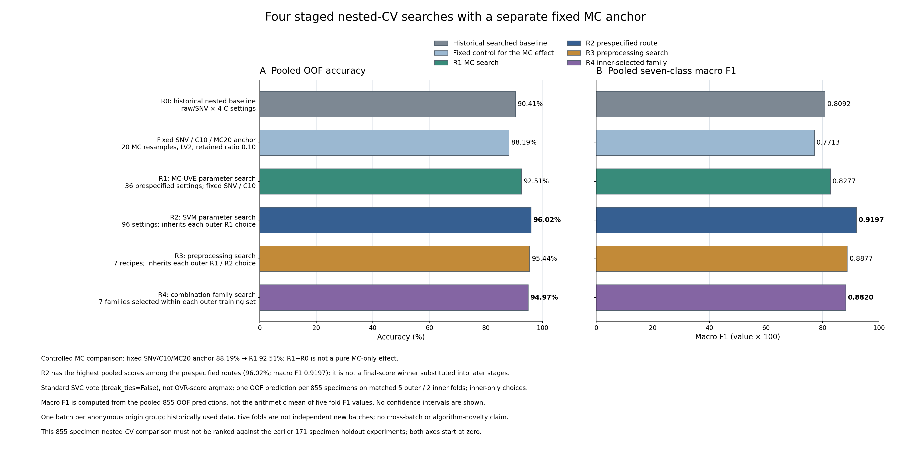
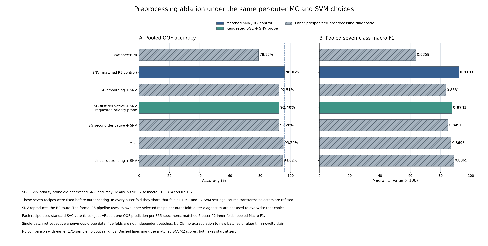
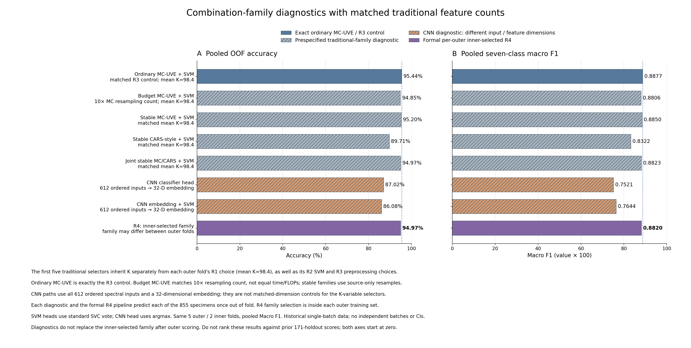

# MC-UVE、SVM、预处理及组合：四轮嵌套实测

2026-10-31。已按用户给出的顺序完成四轮实际运行，并精确复算原基线。**第二轮“MC-UVE参数＋SVM参数搜索”的855份五折OOF准确率为96.0234%，宏F1为0.9197；原方案为90.4094%／0.8092。后续增加预处理选择、稳定组合或CNN没有继续提高这次外层表现。**

本轮使用相同855份编号样品、612个候选频点和旧五外折分区，各样品每种方法恰外测一次。它与此前513／171／171固定预测实验口径不同，不能直接把本次96.02%、旧90.41%和171份上的92.40%混在一起排名。所有数据和历史外层结果此前已曝光，本轮仍属单批次回顾性内部验证，不是独立确认或跨批次泛化成绩。

## 总体结果与严格对照

| 预设策略 | 正确数／855 | 准确率 | 宏F1 | 平衡准确率 |
| --- | ---: | ---: | ---: | ---: |
| R0：原方案精确复现 | 773 | 90.4094% | 0.8092 | 83.6735% |
| 固定SNV／C10／MC20锚定 | 754 | 88.1871% | 0.7713 | 82.0816% |
| R1：MC-UVE参数选择 | 791 | 92.5146% | 0.8277 | 86.6531% |
| R2：继承R1，再选SVM参数 | **821** | **96.0234%** | **0.9197** | **89.9184%** |
| R3：继承R1／R2，再选预处理 | 816 | 95.4386% | 0.8877 | 86.3878% |
| R4：继承R1—3，再选组合家族 | 812 | 94.9708% | 0.8820 | 85.8163% |

R2相对旧R0净增加48份正确，提高**5.6140个百分点**；逐样品比较为纠正62份原错误，同时引入14份新错误。完整改对／改错均保存，不仅展示改善的样品。R2是这批预设路线中观察到的最好结果，没有根据这个外层最高分回头更改R3／R4策略，也没有重新计算一个外层最优参数再冒充嵌套结果。

R1固定SNV和C10，其纯MC参数影响应相对88.1871%的固定锚定判断，提高4.3275个百分点。旧90.41%还包含C与Raw／SNV内调，因此R1与R0的差异不能全部称为单独改变MC参数的效应。

## R0：90.41%的含义已核对并复现

原MC20的20次重复、PLS潜变量2、10%向上取整62点均正确。旧基线在内层同时选择Raw／SNV及C＝0.1／1／10／100，gamma为scale，类别权重balanced；最终五折均选择SNV，C依次为100／10／100／10／100。

本次R0的855个预测标签与旧文件按编号逐项完全相同，仍为773份正确。SVC保持原标准`predict`投票规则；OVR分数argmax在这组预测上仅772份正确，不能偷偷换规则后仍称同一基线。分数和投票不一致的地方单独记录，分数不当作已校准概率。

## R1／R2：实际选择的参数

R1比较MC10／20／50、PLS1／2／3、保留5／10／15／20%，共36设置。对应特征数为`ceil(比例×612)`，即31／62／92／123。固定SNV、C10、gamma scale及balanced，以便研究MC三个因素。

R2继承**当前外折**R1设置，搜索6个C、4种gamma规则、4种类别权重，共96个标称设置。权重为none／balanced／训练频率反比权重的0.5次幂／1.5次幂，并按当前训练样品平均权重归一为1。它是低自由度的训练内类别权重搜索，没有用仅5份ZY02自由拟合七个独立权重。

| 外折 | MC次数 | PLS潜变量 | 保留比例／点数 | R2 C | R2 gamma规则 | R2类别权重 | 后续R3预处理 |
| --- | ---: | ---: | --- | ---: | --- | --- | --- |
| 1 | 10 | 3 | 15%／92 | 100 | 0.1×scale | 频率权重0.5次幂 | SNV |
| 2 | 20 | 1 | 10%／62 | 1000 | 0.1×scale | 频率权重0.5次幂 | SNV |
| 3 | 50 | 1 | 20%／123 | 1000 | scale | none | SG一阶＋SNV |
| 4 | 50 | 1 | 20%／123 | 1000 | 0.1×scale | balanced | MSC |
| 5 | 50 | 1 | 15%／92 | 100 | scale | 频率权重0.5次幂 | SNV |

**R2五折全部仍用SNV。最后一列仅是R3的后续选择，不能把它混入R2的96.02%配方。** 各外折参数不同，不能据此宣布“MC50／PLS1／20%”是所有数据上的唯一最优参数。部署全855模型时还需要另行在全源数据内部选择，不能挑一个外折参数代替该步骤。

gamma使用scale／auto／0.1×scale／10×scale，数值仅在当前训练矩阵的已选特征上计算。StandardScaler后非恒定列方差约1，scale和auto往往都约为`1/K`，表中四个规则不等于四个独立数值。全部实际gamma及别名已导出；CNN的死激活维可能改变此等价关系，同样按实际训练表示计算。

同一训练分区可以复用50次MC系数的10／20前缀，但分别重算各自均值、ddof1标准差和floor。9组合成等价性测试及60组实际前缀检查均通过。这是减少重复计算，不是新的变量选择算法，也不把更多迭代本身当作创新。

## R3：SG一阶＋SNV已经按建议验证

继承各外折R1／R2后比较7种预处理。选中策略在五折为SNV／SNV／SG一阶＋SNV／MSC／SNV。下表是运行前已定义的固定预处理诊断，每折继承同一组上游参数，未根据外测重新调参：

| 预处理 | 准确率 | 宏F1 |
| --- | ---: | ---: |
| Raw | 78.8304% | 0.6359 |
| SNV | **96.0234%** | **0.9197** |
| SG平滑＋SNV | 92.5146% | 0.8331 |
| **SG一阶＋SNV** | **92.3977%** | **0.8743** |
| SG二阶＋SNV | 92.2807% | 0.8491 |
| MSC | 95.2047% | 0.8693 |
| 去趋势＋SNV | 94.6199% | 0.8865 |

因此用户重点提出的SG一阶＋SNV＋MC-UVE＋SVM已经实际运行，但在本轮继承参数条件下未超过SNV。没有穷举所有预处理与MC／SVM的交互组合，也没有声称SG一阶在其他数据或重新联合优化后必然无效。MSC参考、缩放、导数等全部只用当前训练分区，SG窗口15、三阶多项式，导数间隔取原频轴。

## R4：方向A与方向B的完整正负对照

五个频率选择器匹配同样K，按当前外折R1确定，平均98.4点。稳定三族共用10个源分层80%不放回重采样，各类至少2份，保持CARS内部2折可行。MC频率、CARS频率或二者等权频率选点，平频及零支持补位按预定规则处理。另设10倍MC预算，区分更多系数计算与聚合机制；重采样后的有效样本覆盖与普通MC不同，CARS也有额外成本，MC调用数匹配不称严格等FLOPs。

| 预先定义的R4方法 | 准确率 | 宏F1 |
| --- | ---: | ---: |
| 普通MC-UVE，匹配R3 | **95.4386%** | **0.8877** |
| 10倍MC预算 | 94.8538% | 0.8806 |
| 稳定MC-UVE | 95.2047% | 0.8850 |
| 稳定CARS | 89.7076% | 0.8322 |
| MC-UVE／CARS联合稳定频率 | 94.9708% | 0.8823 |
| 1D-CNN原分类头 | 87.0175% | 0.7521 |
| 同一CNN表示＋SVM | 86.0819% | 0.7644 |
| **内层选择的R4策略** | **94.9708%** | **0.8820** |

R4内层分别选择预算MC／普通MC／稳定MC／预算MC／普通MC，不用外层最高分替换这些选择。普通MC控制的全部855个标签和7维分数与R3精确一致。方向A当前未显示超过普通MC的额外收益，方向B的这个固定网络／预算也未胜出，均保留。

CNN每个内层源342份或外层源684份都重新训练；共15个新编码器，200轮、9223参数、32维表示，原头与SVM共享同一编码器。它输入完整612点，不能将32维自动表示称为“选了32个原频点”，也不能把七种家族都称严格同维对照。单一固定架构和种子不能证明所有CNN都无效。

重采样时稀少类内层2份及外层训练4份均被保留，并未产生10批新的稀少类数据。稳定频率／Jaccard只是训练重采样或重叠外折的描述。例如去趋势＋SNV跨外折Jaccard约0.4993，高于SNV的0.4338，但准确率更低；不能只按频率稳定性选模型或将其当作化学峰验证。

## 少数类与误判仍需单列

| ZY02五份样品的指标 | R0 | R1 | R2 | R3 |
| --- | ---: | ---: | ---: | ---: |
| 正确识别数 | 3／5 | 3／5 | **3／5** | 2／5 |
| 被预测为ZY02的样品数 | 10 | 14 | 3 | 2 |
| 精确率 | 30% | 21.43% | **100%** | 100% |
| 召回率 | 60% | 60% | **60%** | 40% |
| F1 | 0.4000 | 0.3158 | **0.7500** | 0.5714 |

R2减少了该类假阳性，但两份真ZY02仍被判为ZY01，编号为ZY02-001、ZY02-004。总体96.02%不表示这类也有96%正确率；其样品仍只有5份，补样优先级不变。全部20条方法角色、855个编号、逐类指标、所有错误及配对变动见[21张表的完整Excel](../reports/staged-nested-optimization/2026-10-31/tables/四轮嵌套CV_完整结果与855样品OOF对照.xlsx)。

## 验证、归档及后续决定

264项测试通过。独立审计复算1540次内层评价／526680条原始内层预测及100个外层方法折角色／17100条OOF，每种方法855份恰一次。R0逐编号复现旧773份正确；全部五折独立选择、变换统计、MC前缀、gamma／类别权重、稳定性、CNN共享权重和实际放行时间均核对通过。所有核心与组合内层锁齐后才统一生成[外层放行记录](../reports/staged-nested-optimization/2026-10-31/outer_evaluation_release.json)，最后只评分，不反向调参。

原始内层指标／预测／源统计按字节归档，190份逐MC系数矩阵保留云端缓存；GitHub保存其原SHA、形状、有序源身份、重建方式及160份去重精确mean／std／floor摘要。审计运行时已逐元素核过原矩阵，不声称归档中包含全部原矩阵。实际模型、来源、源码、协议、审计及恢复记录见[证据目录](../reports/staged-nested-optimization/2026-10-31/README.md)和[模型说明](../models/staged_nested_20261031/README.md)。

当前保存的是各外折684份源训练得到的复现实例，不是一个已经用全855训练的部署模型。R2可作为后续独立数据验证的优先候选；这个判断来自比较预设路线，不是新的独立确认，也不将观察到的最高外测反填为“内层最优”。

本轮结果支持先把MC-UVE及SVM调好，再判断更复杂方法是否有净收益。方向A已完成明确的受控尝试，尚无支持它优于普通MC的证据；方向C仍是有实际意义的长期任务，但当前每产地只有一批，不能凭随机折伪造新批次校准结果。下一步需要真正独立、覆盖同一组产地的新批次，并控制制样／厚度／测量条件后再检验泛化和小样本校准。
