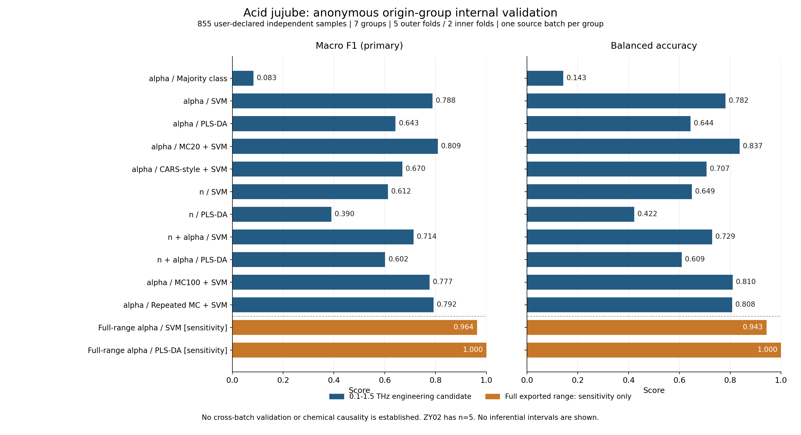

# 酸枣仁批准计划：首轮执行报告

日期：2026-10-31。按[已批准方案](APPROVED_ZAOREN_EXPERIMENT_PLAN.md)在当前云端Python／CPU环境实际执行，不含Gaussian。

**已完成7份有效表格的质量审查、13条分类路径、65个外层测试折、11,115条样品预测及100项工程测试。** 当前结果是用户声明独立样品上的匿名产地组内部验证。用户进一步确认每个产地目前只有一批，因此这些分数不能证明换批次后的产地鉴别能力，也不能分离产地与这批来源样品的影响。

在预先固定的0.1—1.5候选区间，普通**MC20＋SVM**得到90.41%准确率、0.8092宏F1，是该候选区间已测路径中的最高数值。重复稳定筛选和n／α直接拼接均未超过它。完整导出区间的PLS-DA得到100%内部识别，但该区间含较多负吸收值，不能据此将完整区间宣布为物理有效或最优范围。

## 数据、声明与质量

仅使用[当前有效版本](../data/CURRENT_DATASET.md)的7份编号版；原始编号和光谱字节未改。用户的独立样品及单批次声明见[证据记录](../data/annotations/zaoren_user_declaration_20261031.json)。物理ID按这项明确声明映射，匿名组标签`origin_group_verified=true`；真实地名、批次标识和物种鉴定字段没有伪造填充。

| 组别 | 样品数（依据用户声明） | 厚度原标注 |
| --- | ---: | --- |
| ZY01 | 350 | 1.5 mm |
| ZY02 | 5 | 2份1 mm、3份1.5 mm |
| ZY03—ZY07 | 各100 | 1.5 mm |
| 合计 | 855 | 全部保留 |

- n及α各为855×2578，记录和频轴完整配对；导出轴约0.100708—5.998993，表头为`Thz`。单位及仪器信噪／有效区间仍需原始测量记录确认。
- 全矩阵未发现非有限谱值；n、α及联合向量精确重复均为0。全导出区间下、均值中心化余弦阈值0.99999的近重复诊断未命中；这不构成独立样品来源的额外证明。
- α在完整导出区间存在负值，所有7组均有；固定0.1—1.5候选区间内没有负值，对应612点，实际端点约0.100708—1.499176。没有根据模型测试结果裁剪区间，也没有自动删除坏点或样品。
- ZY02厚度条件与其余组不完全一致；导出n／α不能替代对制样和厚度校正的核验。后续应控制这项差异，不能直接把模型重要性归为产地化学原因。
- 当前每产地只有一批；质量报告中批次ID数量为0表示尚无可用的明确编号，不表示样品没有来源批次。

完整数值审计及声明注释的执行时hash见[本轮证据](../reports/approved-zaoren/2026-10-31/README.md)。质量和模型运行后补充的单批次声明单独记录，没有回写成新的模型实验。

## 固定评价协议

采用分层、物理样品互斥的外层5折／内层2折，分区seed为20261031、模型seed为42；每个样品每条路径恰外测一次。ZY02每外折仅1份测试样品、每内层训练分区2份，因此CARS内部交叉验证预先显式设为2折。没有偷偷降低折数、换种子或删除ZY02。

原谱／SNV、缩放、变量筛选和模型参数均在相应训练分区重新拟合。拼接表示按`[n, α]`排列，SNV分块计算。SVM采用RBF核、`class_weight=balanced`、gamma=`scale`，C候选为0.1／1／10／100；one-hot PLS-DA潜变量候选为1／2／3／5／8，按训练维度裁剪。内层以宏F1调参。

全部路径共用相同外／内层分区。外层预测拼接后重新计算准确率、平衡准确率、宏F1、逐类召回和混淆矩阵；不是先挑最好折再汇报。未对旧外部数据或本次测试分数进行挑选后改预算。当前为本地协议，不是外部预注册。

## 候选区间：普通方法和筛选对照

以下输入均为预先固定的612点候选区间；这里的“全点”指这612点，不是完整2578点导出范围。

| α表示与方法 | 准确率 | 平衡准确率 | 宏F1 | 平均保留点数 |
| --- | ---: | ---: | ---: | ---: |
| 多数类参照 | 40.94% | 14.29% | 0.0830 | 输入612，模型忽略谱值 |
| 全点SVM | 88.54% | 78.16% | 0.7878 | 612 |
| 全点PLS-DA | 81.87% | 64.39% | 0.6428 | 612 |
| MC20＋SVM | **90.41%** | **83.67%** | **0.8092** | 62 |
| CARS-style＋SVM | 79.53% | 70.69% | 0.6696 | 122.6 |
| MC100＋SVM | 88.07% | 81.02% | 0.7766 | 62 |
| 重复MC（10×10）＋SVM | 90.29% | 80.82% | 0.7923 | 62 |

MC20相对全点SVM准确率增加1.87个百分点、宏F1增加0.0214，同时将612点缩到62点。重复MC没有超过普通MC20，MC100增加迭代预算也没有得到更高分，均保留为真实负结果。不能将这些差距称为已经统计显著或跨批次稳定。

MC三条路径最终点数相同；重复MC含额外聚合及破同频拟合，不能宣称与MC100每一步严格等计算量。CARS-style的子集大小各折不同，其平均点数与MC不匹配，因此表格也不是所有筛选方法严格等维数、等预算的最终优劣证明。它是本仓库的多分类Python适配，不是老师原始MATLAB论文精度的严格复现。

## n和α的配对信息对照

| 输入与方法 | 准确率 | 平衡准确率 | 宏F1 |
| --- | ---: | ---: | ---: |
| n＋SVM | 75.91% | 64.88% | 0.6124 |
| n＋PLS-DA | 63.74% | 42.24% | 0.3904 |
| n＋α拼接＋SVM | 83.86% | 72.86% | 0.7136 |
| n＋α拼接＋PLS-DA | 78.95% | 60.92% | 0.6016 |

各输入使用同一855份样品和相同分区。α单独的对应分数见上表，拼接没有优于α单独的同类分类器。该结果只检验了预设的直接拼接；不能推广为所有融合方法都无效。n／α来自同一测量链，不是两个独立样品队列。

## 完整导出区间：敏感性对照

| α输入2578点 | 准确率 | 平衡准确率 | 宏F1 | ZY02召回 |
| --- | ---: | ---: | ---: | ---: |
| SVM | 99.77% | 94.29% | 0.9639 | 3/5 |
| PLS-DA | 100.00% | 100.00% | 1.0000 | 5/5 |

这是预设敏感性结果，完整保留。不能据100%将其改成“已经证明产地鉴别完美”或事后替换主区间。当前每产地只有一批，尚不能确定这些分数来自稳定的产地信息，还是这批样品的制样／测量特征；高频存在负α，也需要原始信号和仪器有效区间的核验。

这个对照还说明准确率不能单独使用：完整区间SVM虽有99.77%总体准确率，ZY02仍只识别3/5。该类只有5份，逐类结论很不稳定，优先补样具有实际必要性。



全部指标、逐类召回、预设α-SVM／拼接SVM混淆矩阵和逐样品OOF预测见[证据目录](../reports/approved-zaoren/2026-10-31/README.md)。图中的完整区间路径明确标为敏感性对照；不把选择频率或Jaccard当作p值、FDR或化学峰归属。

## 分类校准：代码已实现，真实实验尚未启动

新增分类迁移入口，比较不适配、仅support简单分类器、源＋support完整Pipeline重训、冻结源表示重训头、分数锚定校准五种方法。固定query、嵌套每类K-shot、开发域选择正则、物理样品／批次隔离、频轴及类别校验均已实现。

完成三类合成工程夹具的CLI端到端运行：21组评价、630条样品预测，均标记`synthetic_engineering_fixture`，真实药材样品数为0。它证明流程能执行，不是酸枣仁小样本改善成绩。真实数据只有每产地一批，未建立独立源／开发／确认批次，因此没有生成真实跨批次识别率。

A/B的SVC保留标准`predict`投票规则；部分输出OVR分数的argmax与它不同，共31处，已经单独审计，指标按实际保存的预测重算而未改分。阶段C预先统一源模型及校准的score-argmax规则，避免把平票方式变化误算成校准收益；分数均不当作概率。

## 复算、测试和下一步

- 对13×855条预测以独立混淆矩阵公式复算，所有指标最大绝对差为0；检查每样品恰外测一次、训练／测试物理ID交集为0、全部方法分区一致。
- 100项现有与新增测试全部通过，包括数据错配拒绝、缺物理组不回填、分块SNV、CARS小样本可行性、固定query、嵌套support、跨角色隔离及最终query标签不影响拟合／选参等。
- 分类矩阵实际约80.9秒，包含缓存和最多2个单线程进程的并行；各方法单次墙钟耗时不解释为多机、多次重复的稳定速度排名。原环境／输入／执行源码hash、命令、日志及分区均归档；约2.2 GB的计算缓存未入库。

**当前取舍：保留α＋SVM／PLS-DA与普通MC-UVE；不将稳定筛选或直接拼接预定为论文最终改进。** 完整区间高分保留为需要独立批次确认的结果，不用于回头改变本轮协议。

下一步优先补7组真实地名映射及原始测量记录，补充ZY02，并收集覆盖同一批已知产地的新来源批次。现有数据作为源区；另设开发批次选择适配规则，再留未参与开发的确认批次。每产地每新批次约30份可作为组织目标，不能当作统计效能保证；真实K、固定query和支持池必须按实际独立样品数落实。各次尽量统一并交错制样测量，记录含水率、粒径、厚度、聚乙烯比例及仪器条件。

## 复现入口

先使用新输出目录准备当前已注释数据：

```bash
.runtime/bin/python scripts/prepare_zaoren_dataset.py --output outputs/zaoren-reproduction/data
```

在完整NPZ上按预定坐标范围同时裁剪`axis`、`X_alpha`及`X_n`，其余字段原样保留，得到612点候选区间NPZ；本轮实际生成规则、hash及冻结脚本见[原始执行证据](../reports/approved-zaoren/2026-10-31/README.md)。不依据y或模型分数确定该掩码。

```bash
.runtime/bin/python - <<'PYTHON'
from pathlib import Path
import numpy as np
source = Path("outputs/zaoren-reproduction/data/dataset.npz")
target = Path("outputs/zaoren-reproduction/candidate_0p1_1p5.npz")
if target.exists():
    raise FileExistsError(target)
with np.load(source, allow_pickle=False) as saved:
    arrays = {key: saved[key] for key in saved.files}
mask = (arrays["axis"] >= 0.1) & (arrays["axis"] <= 1.5)
arrays["axis"] = arrays["axis"][mask]
for key in ("X_alpha", "X_n"):
    arrays[key] = arrays[key][:, mask]
np.savez_compressed(target, **arrays)
PYTHON
```

```bash
.runtime/bin/python scripts/run_zaoren_classification.py --input outputs/zaoren-reproduction/candidate_0p1_1p5.npz --output outputs/zaoren-reproduction/primary --outer-splits 5 --inner-splits 2 --cars-cv 2 --split-seed 20261031 --seed 42 --representations alpha --methods dummy svc plsda mcuve20_svc cars_svc
.runtime/bin/python scripts/run_zaoren_classification.py --input outputs/zaoren-reproduction/candidate_0p1_1p5.npz --output outputs/zaoren-reproduction/modalities --outer-splits 5 --inner-splits 2 --cars-cv 2 --split-seed 20261031 --seed 42 --representations n concat --methods svc plsda
.runtime/bin/python scripts/run_zaoren_classification.py --input outputs/zaoren-reproduction/candidate_0p1_1p5.npz --output outputs/zaoren-reproduction/stability --outer-splits 5 --inner-splits 2 --cars-cv 2 --split-seed 20261031 --seed 42 --representations alpha --methods mcuve100_svc stable_svc
.runtime/bin/python scripts/run_zaoren_classification.py --input outputs/zaoren-reproduction/data/dataset.npz --output outputs/zaoren-reproduction/full-export --outer-splits 5 --inner-splits 2 --cars-cv 2 --split-seed 20261031 --seed 42 --representations alpha --methods svc plsda
```

若上述输出目录已存在，先统一更换复现目录前缀，不覆盖旧结果。未来批次数据完整后，使用`scripts/run_classification_transfer.py --help`配置独立的source／development／target输入；不能把同一当前数据随机分三份后称作跨批次。
