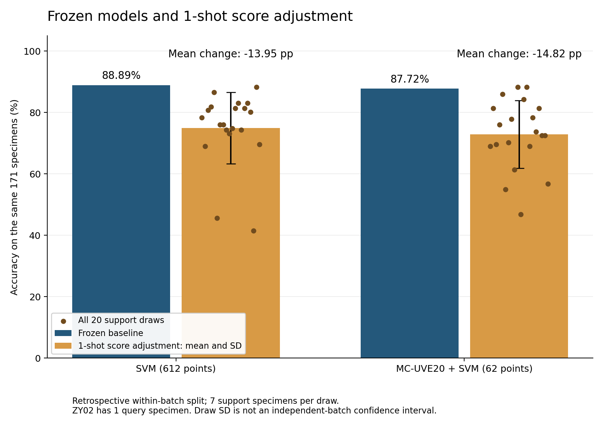

# 酸枣仁训练／校准／预测拆分及实测结果

执行日期：2026-10-31。已完成21份Excel导出、两个冻结源模型、42组评价及7182条逐样品预测。**本次固定的每类1份分数校正没有带来平均改善；全部结果保留，不据此重新挑种子或调整预测组。**

## 三种专用文件

全部855份样品按固定随机种子20261101分层拆分，各样品只属于一个用途。原7份编号版和有效清单保持原样。拆分目录、逐样品归属及数值核验见[三用途数据目录](../data/processed/zaoren_threeway_20261031_v1/README.md)。

| 匿名产地组 | 训练样本专用 | 校准专用池 | 固定预测专用 |
| --- | ---: | ---: | ---: |
| ZY01 | 210 | 70 | 70 |
| ZY02 | 3 | 1 | 1 |
| ZY03 | 60 | 20 | 20 |
| ZY04 | 60 | 20 | 20 |
| ZY05 | 60 | 20 | 20 |
| ZY06 | 60 | 20 | 20 |
| ZY07 | 60 | 20 | 20 |
| 合计 | **513** | **171** | **171** |

- [训练样本专用](../data/processed/zaoren_threeway_20261031_v1/训练样本专用/)：7份Excel及标签表，仅用于源模型参数选择和最终训练。
- [校准专用](../data/processed/zaoren_threeway_20261031_v1/校准专用/)：7份Excel及标签表，组成171份支持样品池；不参与源模型调参。
- [预测专用](../data/processed/zaoren_threeway_20261031_v1/预测专用/)：7份Excel，171份样品保持固定，用于校准前后配对评价；标签另放在[evaluation](../data/processed/zaoren_threeway_20261031_v1/evaluation/prediction_truth.csv)。

每份工作簿保留时域、频域、折射率、吸收系数四表；选中的样品编号、厚度后缀、光谱数值、坐标和参考列均保留，仅将导出列压紧排列。21份共137,894,344字节，最大33,015,811字节。全84张表保留单元格的XML载荷摘要一致、容器CRC通过、7份原件SHA未变。ZY编号及文件分组透露匿名类别，所以这些是用途隔离文件，不是盲样；模型只使用数值光谱，不使用编号或路径。

## 训练、冻结和校准方式

执行前记录[协议](ZAOREN_THREEWAY_PROTOCOL.md)及[机器配置](../data/research/zaoren_threeway_protocol_20261031.json)。预先指定候选区间`0.1≤f≤1.5`的吸收系数，实际612点、0.100708011至1.499176073；本次不重新挑频段。

分别训练612点RBF-SVM与MC-UVE20＋RBF-SVM。仅513份训练样品参加3折CV，原谱／SNV和`C=0.1/1/10/100`按宏F1选择；两模型均选SNV及C=10，`class_weight=balanced`、`gamma=scale`。MC20最终保留62点。每折的预处理、标准化和筛选都只在训练折拟合，然后用513份完整拟合并冻结。

校准仅新增`AnchorScoreCalibrator`分数修正层，正则固定1.0，不更新源模型的SNV、缩放、选择器或SVM。每次从171份校准池按每类1份抽取，共7份，固定种子42生成20次支持抽样，两模型共用同一批编号，预测组始终是171份。没抽到的校准样品不回填预测集；也没有把分类分数当概率。

七类统一3／5／10-shot不可执行，因为ZY02的校准池只有1份，不能删除该类或复制样品补数。本轮不追加按预测结果挑选的校准强度、算法、区间或分区。

## 实际结果

校准结果为全部20次支持抽样的均值；准确率变化为相对于同一源模型的百分点差。

| 模型 | 阶段 | 准确率 | 平衡准确率 | 宏F1 | 准确率变化 |
| --- | --- | ---: | ---: | ---: | ---: |
| 612点SVM | 冻结源模型 | **88.89%（152/171）** | 86.43% | 0.8616 | — |
| 612点SVM | 每类1份分数校正，20次均值 | 74.94% | 73.78% | 0.7066 | **−13.95个百分点** |
| MC20＋SVM | 冻结源模型 | **87.72%（150/171）** | 89.08% | 0.7827 | — |
| MC20＋SVM | 每类1份分数校正，20次均值 | 72.89% | 71.71% | 0.6251 | **−14.82个百分点** |

SVM校准准确率范围41.52%—88.30%，抽样SD为11.60个百分点，20次均低于源模型。MC20校准范围46.78%—88.30%，SD为11.01个百分点，2次提高、18次下降。不能只保留那2次有利结果。



预先指定第0次为示例：SVM由152份正确变为134份，改对5份、改错23份；MC20由150份变为118份，改对0份、改错32份。这不是挑选的最好一次。完整逐类召回、混淆矩阵、所有样品预测和每次支持编号均在[实测归档](../reports/zaoren-threeway/2026-10-31/README.md)。

当前结果说明**这个固定λ=1、每类1份的分数校正方案不适合直接作为现有数据的默认改善步骤**，不能推断所有小样本校准都无效。现有数据也没有新批次分布漂移的独立证据，给同批次随机拆分训练得到的冻结模型附加一个极少样本拟合的修正层不保证获益。若继续研究另一种校准方案，应记录为探索性改进并用新的独立确认数据评价，不能在这171份预测标签上反复调到上涨后仍称独立验证。

## 限制、冻结证据与复现

每产地目前只有一批，全部855份此前已参与内部CV。因此本次是**同批次、回顾性匿名产地组留出评价**；它隔离了本次拟合和评分，却不是首次未见确认集或跨批次实测。20次抽样共用预测样品及唯一的ZY02校准样品，其SD不代表20个独立批次的不确定性。

ZY02只有1份预测样品，召回只能0%或100%。两源模型恰好都识别对这1份，但MC20另外把8份ZY01错判成ZY02；这也解释了其平衡准确率较高而宏F1较低，不能仅看少数类召回宣布该类可靠。

固定分区中ZY02训练为001（1 mm）、004／005（1.5 mm），校准为002（1 mm），预测为003（1.5 mm）；其余样品均为1.5 mm。校准与预测的厚度组成不同是制样混杂风险，但这一次结果不足以证明下降由厚度导致。厚度说明是运行后附注，没有据此调整分区或重训。

两个冻结模型已原样保存到[模型目录](../models/zaoren_threeway_20261031/README.md)，文件SHA与本次源模型原件一致。20次校准前后拟合对象指纹一致，重新加载模型后完整重现171份源预测，未新增拟合。预测结果先保存，再交给独立评分函数；预测真值置乱不影响模型、校准系数或已生成预测。

114项测试通过。独立审查另从7182条预测用混淆矩阵公式重算42组指标和改对／改错数，最大差`3.33e-16`；确认源CV编号仅来自训练组、三组互斥、20次支持编号共享、模型hash及输入hash匹配。记录见[独立审查](../reports/zaoren-threeway/2026-10-31/independent_audit.json)。

在已安装本项目依赖的环境中，用新输出目录复现：

```bash
python scripts/split_zaoren_workbooks.py --output outputs/threeway-reproduced --seed 20261101
python scripts/prepare_zaoren_dataset.py --output outputs/threeway-source-reproduced
python scripts/run_within_batch_holdout.py --input outputs/threeway-source-reproduced/dataset.npz --split-plan outputs/threeway-reproduced/split_plan.json --protocol data/research/zaoren_threeway_protocol_20261031.json --output outputs/threeway-models-reproduced
```

原始输入及原跨批次门禁未改；本轮未运行MATLAB、Gaussian或Colab，实验由现有云端Python CPU环境完成。
