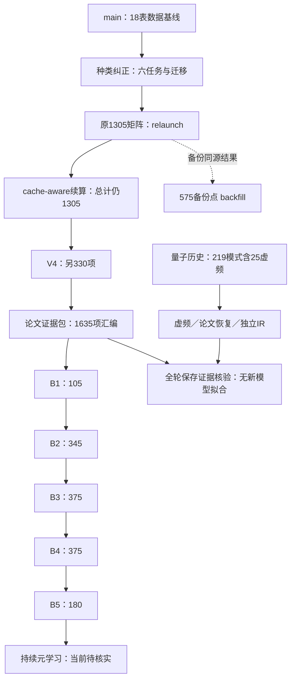

# 全部分支与资料区域

盘点范围为2026-11-12发现的31个已有远程分支。Git提交时间、合并状态与科研任务状态分别记录。ahead/behind按与本次main固定提交的可达提交数计算，不表示成果数量或落后天数。

除main本身外，data确认分支已合main且文件tree完全相同；其余研究分支仍各自保存独立历史。本次新增的整理分支不计科研分支或训练轮次。

## 01 数据与登记

|分支／固定提交|用途与当前结论|相对main|PR与证据|
|---|---|---|---|
|[data/confirmed-origins-20261108](https://github.com/jackzhu119/research4/tree/8119d5635ea1dd4eb5a0c5212893b7c0d7a37309) `8119d563`|已合入。数据命名/种类与来源确认，已合main；不是训练轮次。|已合main；+0／−1|[#3](https://github.com/jackzhu119/research4/pull/3) 已合并；[1](https://github.com/jackzhu119/research4/blob/8119d5635ea1dd4eb5a0c5212893b7c0d7a37309/data/active_workbooks.json)、[2](https://github.com/jackzhu119/research4/blob/8119d5635ea1dd4eb5a0c5212893b7c0d7a37309/data/confirmed_names_20261108.csv)|
|[main](https://github.com/jackzhu119/research4/tree/806584a5571c6a90ef37c6bfa915671b680ba48b) `806584a5`|数据基线。当前默认数据入口；18表1672谱。data确认分支已合入且tree相同；本分支尚未包括817份后续独立实物声明。|已合main；+0／−0|无对应PR；[1](https://github.com/jackzhu119/research4/blob/806584a5571c6a90ef37c6bfa915671b680ba48b/data/CURRENT_DATASET.md)、[2](https://github.com/jackzhu119/research4/blob/806584a5571c6a90ef37c6bfa915671b680ba48b/data/active_workbooks.json)|

## 02 历史混种算法

|分支／固定提交|用途与当前结论|相对main|PR与证据|
|---|---|---|---|
|[research/algorithm-review-and-baselines-20261030](https://github.com/jackzhu119/research4/tree/3fc996e99cce8ff5799b5a2af9b565f982dfc899) `3fc996e9`|历史已结束。原855混合枣仁/酸枣仁七来源任务；多个轮次共存同分支，R0复现旧基线不能重复计算为新实验。历史96.0234%不可移作纯酸枣仁成绩。|未合main；+37／−2|[#1](https://github.com/jackzhu119/research4/pull/1) open；[1](https://github.com/jackzhu119/research4/blob/3fc996e99cce8ff5799b5a2af9b565f982dfc899/docs/ZAOREN_APPROVED_EXECUTION_REPORT.md)、[2](https://github.com/jackzhu119/research4/blob/3fc996e99cce8ff5799b5a2af9b565f982dfc899/docs/MULTIROUND_OPTIMIZATION_REPORT.md)、[3](https://github.com/jackzhu119/research4/blob/3fc996e99cce8ff5799b5a2af9b565f982dfc899/docs/STAGED_NESTED_OPTIMIZATION_REPORT.md)、[4](https://github.com/jackzhu119/research4/blob/3fc996e99cce8ff5799b5a2af9b565f982dfc899/docs/RESEARCH4_EXPERIMENT_AUDIT.md)|
|[research/supplemental-spectra-20261104](https://github.com/jackzhu119/research4/tree/765742a10d516aff66079f748c9ba3ffcd8ce933) `765742a1`|历史已结束。补充光谱/时域修复/黄芪天麻与跨植物预算对照；继承算法/PySCF历史文件不再增计。|未合main；+88／−2|无对应PR；[1](https://github.com/jackzhu119/research4/blob/765742a10d516aff66079f748c9ba3ffcd8ce933/docs/SUPPLEMENTAL_SPECTRA_RESULTS_20261104.md)、[2](https://github.com/jackzhu119/research4/blob/765742a10d516aff66079f748c9ba3ffcd8ce933/docs/SUPPLEMENTAL_MULTIREPRESENTATION_RESULTS_20261104.md)、[3](https://github.com/jackzhu119/research4/blob/765742a10d516aff66079f748c9ba3ffcd8ce933/docs/CONSERVATIVE_CROSS_PLANT_BUDGET_ABLATION_20261104.md)|

## 03 种类纠正与识别

|分支／固定提交|用途与当前结论|相对main|PR与证据|
|---|---|---|---|
|[research/cache-aware-continuation-20261108](https://github.com/jackzhu119/research4/tree/df3e12656e2177cfcf0a298e66bdedc5c524cb74) `df3e1265`|续算已结束。同一1305矩阵825已结束（225经典+600神经），本续算480剩余神经；沿原数据/参数/预算，完成模型不重训。最终1305，不是1305+825+480。|未合main；+8／−10|无对应PR；[1](https://github.com/jackzhu119/research4/blob/df3e12656e2177cfcf0a298e66bdedc5c524cb74/README.md)、[2](https://github.com/jackzhu119/research4/blob/df3e12656e2177cfcf0a298e66bdedc5c524cb74/CURRENT_RUNTIME_CONTROLLER.json)、[3](https://github.com/jackzhu119/research4/blob/df3e12656e2177cfcf0a298e66bdedc5c524cb74/reports/00480/complete.json)、[4](https://github.com/jackzhu119/research4/tree/df3e12656e2177cfcf0a298e66bdedc5c524cb74/reports/00480)|
|[research/evidence-driven-validation-90000-20261108](https://github.com/jackzhu119/research4/tree/71a303e089c7c7b7b2557d62372aaceda44e2f91) `71a303e0`|已结束。新增匹配特征预算/表示迁移验证330项（15经典+315神经）；V3 MLP失败后V4修复标签编码，失败成本保留，不把V3/V4同任务重复计数。|未合main；+69／−0|无对应PR；[1](https://github.com/jackzhu119/research4/blob/71a303e089c7c7b7b2557d62372aaceda44e2f91/docs/EVIDENCE_DRIVEN_VALIDATION_20261108.md)、[2](https://github.com/jackzhu119/research4/blob/71a303e089c7c7b7b2557d62372aaceda44e2f91/docs/CROSS_BRANCH_EVIDENCE_AUDIT_20261108.md)、[3](https://github.com/jackzhu119/research4/tree/71a303e089c7c7b7b2557d62372aaceda44e2f91/data/research/evidence_validation_20261108_v4)|
|[research/species-label-correction-20261108](https://github.com/jackzhu119/research4/tree/0156e2189d13456d1faf05ebfd53d86eeeb4f5e7) `0156e218`|已结束。六项固定留出分类及三种子迁移完成；本分支早期后台摘要已被relaunch/cache continuation后续证据覆盖。817份用户独立性声明在此，不改原18表hash。|未合main；+3／−0|[#4](https://github.com/jackzhu119/research4/pull/4) open；[1](https://github.com/jackzhu119/research4/blob/0156e2189d13456d1faf05ebfd53d86eeeb4f5e7/docs/SPECIES_REVISION_RESULTS_20261108.md)、[2](https://github.com/jackzhu119/research4/blob/0156e2189d13456d1faf05ebfd53d86eeeb4f5e7/data/annotations/specimen_independence_user_declaration_20261108.json)、[3](https://github.com/jackzhu119/research4/tree/0156e2189d13456d1faf05ebfd53d86eeeb4f5e7/data/research/species_revision_20261108)|
|[research/species-reconciliation-audit-20261108](https://github.com/jackzhu119/research4/tree/debb2402edf8eea6a132da124abb1411b68d3219) `debb2402`|核验已结束。纠正旧混种成绩解释、核对已完成纠正实验并衔接后台；对原预测重分解不等于重训。|未合main；+165／−2|无对应PR；[1](https://github.com/jackzhu119/research4/blob/debb2402edf8eea6a132da124abb1411b68d3219/docs/RESEARCH4_SPECIES_CORRECTION_HANDOFF_20261108.md)、[2](https://github.com/jackzhu119/research4/blob/debb2402edf8eea6a132da124abb1411b68d3219/docs/RESEARCH4_72H_BATCH_REVIEW_20261108.md)|
|[research/species-relaunch-90000-20261108](https://github.com/jackzhu119/research4/tree/8a388b8b4d8a5baf9f2e4321e76455c2c0b49eca) `8a388b8b`|旧进度已被接续。新授权90,000 CPU秒下的1305任务原矩阵；分支上旧进度不足以代表最终完成。后续cache-aware沿同矩阵完成剩余480神经任务，统一计1305。|未合main；+38／−0|无对应PR；[1](https://github.com/jackzhu119/research4/blob/8a388b8b4d8a5baf9f2e4321e76455c2c0b49eca/docs/SPECIES_RELAUNCH_90000_20261108.md)、[2](https://github.com/jackzhu119/research4/tree/8a388b8b4d8a5baf9f2e4321e76455c2c0b49eca/data/research/species_relaunch_20261108_v2)|

## 04 B机制第1至5轮

|分支／固定提交|用途与当前结论|相对main|PR与证据|
|---|---|---|---|
|[research/b-mechanism-gaps-20261110](https://github.com/jackzhu119/research4/tree/76966534df314e5bcb108a1fdccd611d1ad52910) `76966534`|已结束。第1轮105/105唯一任务包；后轮复制本结果目录不增计。|未合main；+86／−0|[#6](https://github.com/jackzhu119/research4/pull/6) open；[1](https://github.com/jackzhu119/research4/blob/76966534df314e5bcb108a1fdccd611d1ad52910/docs/B_MECHANISM_GAP_RESULTS_20261110.md)、[2](https://github.com/jackzhu119/research4/blob/76966534df314e5bcb108a1fdccd611d1ad52910/reports/b_mechanism_20261110/artifact_verification.json)|
|[research/b-mechanism-followup-20261110](https://github.com/jackzhu119/research4/tree/ad21deecbb53371f9b4547646a2aa985d8f617fb) `ad21deec`|已结束。第2轮345/345，是新机制矩阵而非重复第一轮；内含前轮原样报告。|未合main；+88／−0|[#7](https://github.com/jackzhu119/research4/pull/7) open；[1](https://github.com/jackzhu119/research4/blob/ad21deecbb53371f9b4547646a2aa985d8f617fb/docs/B_MECHANISM_FOLLOWUP_RESULTS_20261110.md)、[2](https://github.com/jackzhu119/research4/blob/ad21deecbb53371f9b4547646a2aa985d8f617fb/reports/b_mechanism_followup_20261110/artifact_verification.json)|
|[research/b-mechanism-round3-20261110](https://github.com/jackzhu119/research4/tree/69354eb7e2ec726ac5f5568fdac1035afff36da6) `69354eb7`|已结束。第3轮375/375；与前两轮不同输入hash/矩阵，继承目录不算新增。|未合main；+90／−0|[#8](https://github.com/jackzhu119/research4/pull/8) open；[1](https://github.com/jackzhu119/research4/blob/69354eb7e2ec726ac5f5568fdac1035afff36da6/docs/B_MECHANISM_ROUND3_RESULTS_20261110.md)、[2](https://github.com/jackzhu119/research4/blob/69354eb7e2ec726ac5f5568fdac1035afff36da6/reports/b_mechanism_round3_20261110/artifact_verification.json)|
|[research/b-mechanism-round4-20261111](https://github.com/jackzhu119/research4/tree/bbab5a9de3f3e79fe8b12dd5e06c29547e3b9778) `bbab5a9d`|已结束。第4轮375/375；已核验弱证书等额外检查。|未合main；+92／−0|[#9](https://github.com/jackzhu119/research4/pull/9) open；[1](https://github.com/jackzhu119/research4/blob/bbab5a9de3f3e79fe8b12dd5e06c29547e3b9778/docs/B_MECHANISM_ROUND4_RESULTS_20261111.md)、[2](https://github.com/jackzhu119/research4/blob/bbab5a9de3f3e79fe8b12dd5e06c29547e3b9778/reports/b_mechanism_round4_20261111/artifact_verification.json)|
|[research/b-mechanism-round5-20261111](https://github.com/jackzhu119/research4/tree/647f069c1ed4d56b098689571f43074b581a0cc0) `647f069c`|已结束。第5轮180/180；五轮共1380唯一任务包、4792新增分类器拟合，全部E05新批次仍待数据。|未合main；+94／−0|[#10](https://github.com/jackzhu119/research4/pull/10) open；[1](https://github.com/jackzhu119/research4/blob/647f069c1ed4d56b098689571f43074b581a0cc0/docs/B_MECHANISM_ROUND5_RESULTS_20261111.md)、[2](https://github.com/jackzhu119/research4/blob/647f069c1ed4d56b098689571f43074b581a0cc0/reports/b_mechanism_round5_20261111/artifact_verification.json)|

## 05 当前接续与待确认

|分支／固定提交|用途与当前结论|相对main|PR与证据|
|---|---|---|---|
|[research/all-round-validation-20261112](https://github.com/jackzhu119/research4/tree/516de760b3bf72143269f76c904cc35df7b69f76) `516de760`|近期心跳在算。ML复核已完成；量子publication/IR心跳运行。原儿茶酸IR第16模式、毛蕊异黄酮导数35/396，与另外两条计算线重叠。|未合main；+238／−0|[#14](https://github.com/jackzhu119/research4/pull/14) open；[1](https://github.com/jackzhu119/research4/blob/516de760b3bf72143269f76c904cc35df7b69f76/docs/ALL_ROUND_VALIDATION_20261112.md)、[2](https://github.com/jackzhu119/research4/blob/516de760b3bf72143269f76c904cc35df7b69f76/reports/all_round_validation_20261112/ml_round_audit.json)、[3](https://github.com/jackzhu119/research4/tree/516de760b3bf72143269f76c904cc35df7b69f76/reports/all_round_validation_20261112)|
|[research/meta-learning-continuous-20261111](https://github.com/jackzhu119/research4/tree/2d5062d79d760682eaeaf61f02f56d78a02f29ce) `2d5062d7`|当前待核实。2026-11-11快照45上下文初始检查点/51备份文件，不含全部后续评估；历史已启动不证明目前仍在训练，更不能称完成。|未合main；+95／−0|无对应PR；[1](https://github.com/jackzhu119/research4/blob/2d5062d79d760682eaeaf61f02f56d78a02f29ce/docs/META_LEARNING_BACKGROUND_RUNBOOK_20261111.md)、[2](https://github.com/jackzhu119/research4/blob/2d5062d79d760682eaeaf61f02f56d78a02f29ce/docs/META_LEARNING_CONTINUOUS_PROTOCOL_20261111.md)、[3](https://github.com/jackzhu119/research4/blob/2d5062d79d760682eaeaf61f02f56d78a02f29ce/docs/META_LEARNING_EVIDENCE_AUDIT_20261111.md)|

## 06 回传备份与部署

|分支／固定提交|用途与当前结论|相对main|PR与证据|
|---|---|---|---|
|[research/parallel-worker-b-20261106](https://github.com/jackzhu119/research4/tree/c2284ad4755b223830aeb2283d7491a3a3f35a28) `c2284ad4`|部署完成。另一主机冻结计算包及真实水资格控制；部署包本身不是新一轮全量科学结果。|未合main；+111／−2|无对应PR；[1](https://github.com/jackzhu119/research4/blob/c2284ad4755b223830aeb2283d7491a3a3f35a28/docs/RESEARCH4_PARALLEL_CLOUD_PLAN_20261106.md)、[2](https://github.com/jackzhu119/research4/blob/c2284ad4755b223830aeb2283d7491a3a3f35a28/docs/RESEARCH4_WORKER_B_QUICKSTART_20261106.md)|
|[research/parallel-worker-b-20261106-B20261106-01](https://github.com/jackzhu119/research4/tree/4e6e65fe4471f8a8e3c876d6fb4327e824d90f1b) `4e6e65fe`|历史已结束。真实B主机12阶段封印、后续诊断和20次种类误用控制拟合；更晚结果应覆盖旧等待摘要。|未合main；+443／−2|无对应PR；[1](https://github.com/jackzhu119/research4/tree/4e6e65fe4471f8a8e3c876d6fb4327e824d90f1b/reports/parallel-cloud-20261106/worker-b/B20261106-01)、[2](https://github.com/jackzhu119/research4/tree/4e6e65fe4471f8a8e3c876d6fb4327e824d90f1b/docs/writing-20261109)|
|[research/species-results-backfill-20261108](https://github.com/jackzhu119/research4/tree/f38113e51072f0a99c864b2e6dae79a9169ff93c) `f38113e5`|备份完成。备份点00575的已封存2193文件/17分卷，后于源运行复制到独立备份分支；无新增模型拟合，不能另算575训练。|未合main；+10／−10|无对应PR；[1](https://github.com/jackzhu119/research4/blob/f38113e51072f0a99c864b2e6dae79a9169ff93c/README.md)、[2](https://github.com/jackzhu119/research4/blob/f38113e51072f0a99c864b2e6dae79a9169ff93c/backfill_result.json)、[3](https://github.com/jackzhu119/research4/blob/f38113e51072f0a99c864b2e6dae79a9169ff93c/manifest.json)、[4](https://github.com/jackzhu119/research4/blob/f38113e51072f0a99c864b2e6dae79a9169ff93c/evidence/LATEST_BACKGROUND_RESULTS.md)|
|[research/worker-b-bootstrap-20261106](https://github.com/jackzhu119/research4/tree/294f0cfe6626d9b95df3f7b7b8fdd3c40f2f205b) `294f0cfe`|部署完成。一键认证/启动文档与脚本，继承worker包；不新增科学轮次。|未合main；+114／−2|无对应PR；[1](https://github.com/jackzhu119/research4/blob/294f0cfe6626d9b95df3f7b7b8fdd3c40f2f205b/docs/RESEARCH4_WORKER_B_ONE_COMMAND_20261106.md)|

## 07 量子化学历史与修复

|分支／固定提交|用途与当前结论|相对main|PR与证据|
|---|---|---|---|
|[research/parallel-spinosin-ir-900000-20261112](https://github.com/jackzhu119/research4/tree/57041ddd22b647cf7718fd5f351594f17ccdd7b7) `57041ddd`|已启动，部分依赖等待。斯皮诺素严格几何与毛蕊异黄酮前驱IR已启动；斯皮诺素IR进程等待驻点/模式来源，三路均未验收完成。|未合main；+241／−0|[#15](https://github.com/jackzhu119/research4/pull/15) open；[1](https://github.com/jackzhu119/research4/blob/57041ddd22b647cf7718fd5f351594f17ccdd7b7/reports/pyscf_parallel_missing_20261112/background_state.json)|
|[research/postrun-analysis-20261106](https://github.com/jackzhu119/research4/tree/592a62aef75d25252b7513330f9944a9fa4c08dd) `592a62ae`|历史诊断快照。Host A旧曲率/响应诊断和结果闭合；其中历史正在运行文字需用更晚账本覆盖。不是新增分类训练。|未合main；+138／−2|无对应PR；[1](https://github.com/jackzhu119/research4/blob/592a62aef75d25252b7513330f9944a9fa4c08dd/docs/RESEARCH4_POSTRUN_ANALYSIS_20261106.md)、[2](https://github.com/jackzhu119/research4/blob/592a62aef75d25252b7513330f9944a9fa4c08dd/docs/RESEARCH4_HOST_A_DIAGNOSTIC_CONTINUATION_20261106.md)|
|[research/pyscf-autonomous-90000-20261108](https://github.com/jackzhu119/research4/tree/66f2890724d0afb4d46d693701183b9a030d4a39) `66f28907`|历史队列结果。原90,000 CPU秒有限量子队列真实结果；具体成功失败/剩余缺口由量子审计补全。|未合main；+57／−0|无对应PR；[1](https://github.com/jackzhu119/research4/blob/66f2890724d0afb4d46d693701183b9a030d4a39/docs/PYSCF_BACKLOG_AUDIT_20261108.md)|
|[research/pyscf-frequency-repair-20261111](https://github.com/jackzhu119/research4/tree/d8dc8bf47cc024a1dd48549dae2a37492dc3ef3e) `d8dc8bf4`|当前待核实。09:02北京时间仅证明云重启后恢复；progress.json仍是11/11水控制快照，当前存活待核实。|未合main；+99／−0|[#11](https://github.com/jackzhu119/research4/pull/11) open；[1](https://github.com/jackzhu119/research4/blob/d8dc8bf47cc024a1dd48549dae2a37492dc3ef3e/docs/PYSCF_REPAIR_PROTOCOL_20261111.md)、[2](https://github.com/jackzhu119/research4/blob/d8dc8bf47cc024a1dd48549dae2a37492dc3ef3e/docs/PYSCF_REPAIR_RESULTS_20261111.md)|
|[research/pyscf-ir-strength-repair-20261111](https://github.com/jackzhu119/research4/tree/a28d290fb6f8c98c53a068cc364ce7eeb78f6b6d) `a28d290f`|近期心跳在算。原儿茶酸direct/grid5独立IR已合格；df-grid5逐模式偶极第32模式仍在计算，毛蕊异黄酮/斯皮诺素未全部合格。|未合main；+236／−0|[#13](https://github.com/jackzhu119/research4/pull/13) open；[1](https://github.com/jackzhu119/research4/blob/a28d290fb6f8c98c53a068cc364ce7eeb78f6b6d/docs/PYSCF_IR_REPAIR_20261111.md)|
|[research/pyscf-publication-recovery-20261111](https://github.com/jackzhu119/research4/tree/8504167d6feefba5cfe82b715b5b671bcde4647a) `8504167d`|近期心跳在算。毛蕊异黄酮完整数值导数61/396；斯皮诺素在原顺序队列未全部合格；新并行线已立即补其几何计算。|未合main；+225／−0|[#12](https://github.com/jackzhu119/research4/pull/12) open；[1](https://github.com/jackzhu119/research4/blob/8504167d6feefba5cfe82b715b5b671bcde4647a/docs/PYSCF_PUBLICATION_RECOVERY_20261111.md)|
|[research/pyscf-spinosin-mechanism-20261031](https://github.com/jackzhu119/research4/tree/cd4b50c37c1e26064f9f15f340d30e20ac386458) `cd4b50c3`|旧计算闭合，科学未过关。旧219模式完整但194正/25虚，IR NOT_COMPUTED；后续诊断不等于重新获得完整合格频谱。|未合main；+164／−2|[#2](https://github.com/jackzhu119/research4/pull/2) open；[1](https://github.com/jackzhu119/research4/blob/cd4b50c37c1e26064f9f15f340d30e20ac386458/docs/PYSCF_SPINOSIN_COMPLETION_20261106.md)、[2](https://github.com/jackzhu119/research4/blob/cd4b50c37c1e26064f9f15f340d30e20ac386458/docs/FIXED_GRID_STEP_CONVERGENCE_20261107.md)、[3](https://github.com/jackzhu119/research4/blob/cd4b50c37c1e26064f9f15f340d30e20ac386458/docs/RESEARCH4_72H_BATCH_REVIEW_20261108.md)|
|[research/spinosin-conformers-parallel-900000-20261112](https://github.com/jackzhu119/research4/tree/fed40f975d097fbfafcac6c799fc50983a51a2d0) `fed40f97`|准备中，未启动。仅有job_claim，明确尚未启动；不同起始构象作为补充，最终仍须按几何去重。|未合main；+225／−0|无对应PR；[1](https://github.com/jackzhu119/research4/blob/fed40f975d097fbfafcac6c799fc50983a51a2d0/reports/spinosin_conformers_parallel_20261112/job_claim.json)|
|[research/spinosin-grid7-parallel-20261112](https://github.com/jackzhu119/research4/tree/af8006d8a74df02739f3c07ac180aa9d683c4354) `af8006d8`|启动前已替代。未启动且active_jobs为空；被C002/C003构象方案替代，900000 CPU秒授权转移而非另增。|未合main；+226／−0|无对应PR；[1](https://github.com/jackzhu119/research4/blob/af8006d8a74df02739f3c07ac180aa9d683c4354/reports/spinosin_grid7_parallel_20261112/job_claim.json)|

## 08 论文与证据汇编

|分支／固定提交|用途与当前结论|相对main|PR与证据|
|---|---|---|---|
|[docs/paper-writing-evidence-20261109](https://github.com/jackzhu119/research4/tree/01604532a1232620681a7fbece7698fbf678d216) `01604532`|资料整理完成。main上的论文写作证据包/93实验家族整理；同源报告再次包装不算新训练。|未合main；+1／−0|[#5](https://github.com/jackzhu119/research4/pull/5) open；[1](https://github.com/jackzhu119/research4/tree/01604532a1232620681a7fbece7698fbf678d216/docs/paper_bundle_20261109)|
|[research/paper-evidence-compendium-20261109](https://github.com/jackzhu119/research4/tree/b051733989161517a68c4a60cce75766880c95f5) `b0517339`|资料整理完成。便携论文证据213文件/1635作业=旧1305+新330；汇编、混淆矩阵复算和预测归档不是1635次新增训练。|未合main；+84／−0|无对应PR；[1](https://github.com/jackzhu119/research4/tree/b051733989161517a68c4a60cce75766880c95f5/reports/paper-evidence-20261109)、[2](https://github.com/jackzhu119/research4/tree/b051733989161517a68c4a60cce75766880c95f5/docs/paper-writing-20261109)|

## 关键谱系与去重

以下按工作接续关系排列；完整Git父提交保存在 `branches.json` 的 `parents`，不把流程图冒充每个提交的父图。

论文写作分支是main上的资料包，与research分支的便携证据汇编分开保存。Worker B部署、bootstrap、回传分支均有明确区域，但不是按分支数增加训练轮数。

脚本只更新Git元数据和新分支占位，人工科研状态需按心跳与验收回执更新。详情见[总览](README.md)与[逐轮台账](ROUNDS.md)。
