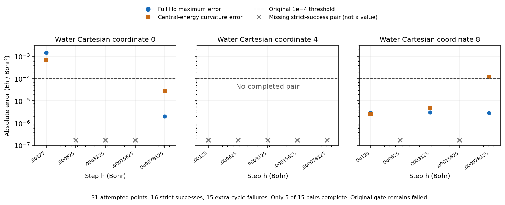

# Independent diagnosis of the initial water convergence attempt

The original scientific gate remains failed. All 31 prescribed SCF points were attempted: 16 met the strict endpoint test and produced gradients; 15 were rejected. The closed guardian phase used **13.712143 CPU seconds**, exited with code 2, and records no CPU, wall, memory, hard-kill or monitor termination.

All 15 failures first met the strict energy **AND** orbital-gradient test in an ordinary SCF cycle, then failed it in PySCF’s final extra cycle. Native `scf/hf.py` returns that final result without resuming the ordinary loop. The failed runs used only 6–21 ordinary cycles of a configured maximum of 80. Six final failures were energy-only, six orbital-gradient-only and three both. The nine orbital-gradient failures were coordinate 4, with final norms approximately 1.015e-9 to 1.708e-9 against the unchanged 1e-9 threshold.

These are failed endpoints under the stated contract. A separately bounded continuation or strict stationarity refinement can seek successful endpoints; an earlier accepted iterate does not authorize changing the saved failed result. No threshold has been relaxed.

Only five of the fifteen plus/minus pairs have two genuinely successful endpoints. Independent scalar replay reproduces all five full-vector maximum errors and `math.fsum` central-energy curvatures exactly. Missing pairs remain missing, and no adjacent-step halving comparison is complete.

| Coordinate | h (Bohr) | Full Hq maximum error | Central-energy curvature error | Original energy check |
|---:|---:|---:|---:|---|
| 0 | 0.00125 | 0.0014278636 | 0.000713209753 | failed |
| 0 | 7.8125e-05 | 2.013801e-06 | 2.76464409e-05 | passed |
| 8 | 0.00125 | 3.00124723e-06 | 2.57993837e-06 | passed |
| 8 | 0.0003125 | 3.13605833e-06 | 4.99009932e-06 | passed |
| 8 | 7.8125e-05 | 2.92168041e-06 | 0.00011870118 | failed |

Errors are in Eh/Bohr². The original absolute threshold is 1e-4 for both displayed quantities.

The finest coordinate-8 pair independently fails its energy check: error **1.1870e-4**, while its full-Hq error is **2.9217e-6**. At h=0.000078125 Bohr, its central-energy numerator is 7.6739e-13 Eh, versus an analytic expectation of roughly 4.2892e-14 Eh. The residual numerator is 7.2449e-13 Eh, above the original allowed 6.1035e-13 Eh. A single stored-energy ULP near E0 is 1.4211e-14 Eh and becomes 2.3283e-6 Eh/Bohr² after division by h². Accurate summation cannot recover accuracy lost in the underlying total energies. The observed residual exceeds final storage/summation rounding alone; its particular upstream source remains unproven.

Coordinate 0’s full-Hq error improves from 1.4279e-3 at the coarsest completed step to 2.0138e-6 at the finest. Coordinate 8’s full-Hq errors remain near 3e-6, but its energy error worsens at the finest step. The successful subset is useful diagnostic evidence, not verified convergence of the full predetermined control.

All 31 child-result references, all 31 input hashes, every declared saved-array reference and every declared successful-checkpoint hash were verified. Every current child file was also hashed; hashes first recorded by this review are explicitly distinguished from producer-verified hashes in `diagnosis.json`. Checkpoints and arrays were hashed as bytes, not loaded for calculations. All child worker records identify the frozen f965 source.

The JSON records every endpoint, source hashes, historical closed-phase flags and all child-file hashes. This review performed no quantum calculation or Git operation and makes no authorization, upload, new-Hessian, minimum or IR claim. Preserve the incomplete attempt and cost. Obtain genuine endpoints under strict refinement before evaluating the unchanged gate; if energy precision remains inadequate, document it and preregister an uncertainty-aware finite-window design rather than selecting a passing subset.
