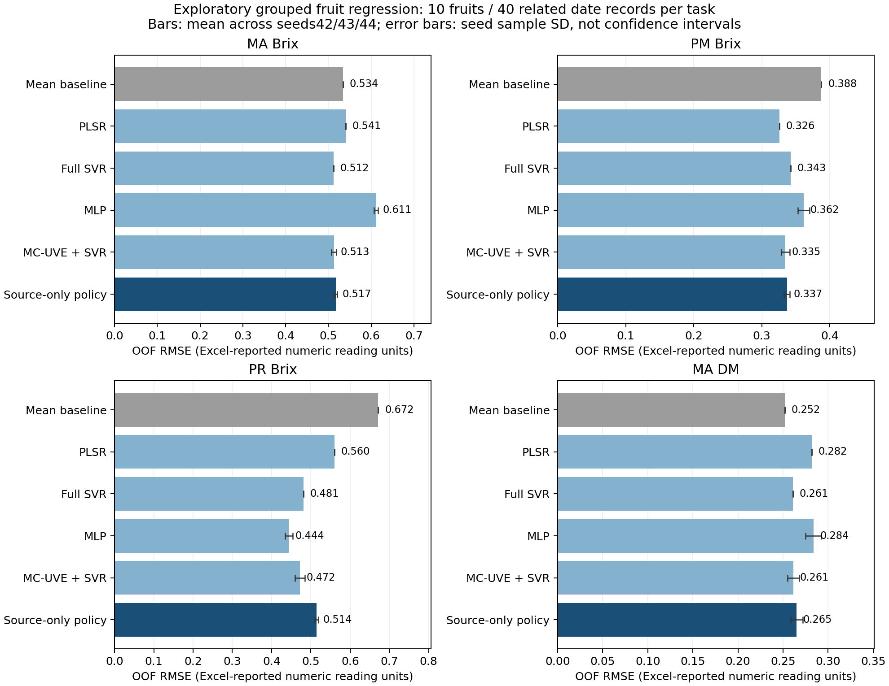

# 水果分组回归：冻结外层预测与独立指标复算

本次已实际完成4个分开的水果数值回归任务。**source-policy在3个Brix任务的RMSE较源均值基线降低3.21%／13.06%／23.40%，在MA-DM任务反而恶化5.19%。** 不能把这些回归误差变化称为分类准确率提高，也不能与酸枣仁96.02%直接比较。

每任务仅10个持续果实ID、40条相关日期记录，MA-DM与MA-Brix共享同一批果实和波形。4个固定日期同时覆盖训练与预测，当前属于留出果实的工程回归探索。时间／THz频率单位、Excel Brix／DM测定方法和数据再分发许可未完全核实；不称新时间、新批次、湿化学含量确认或药材THz-TDS迁移。

## 预先锁定的主策略结果

source-policy在各外折按源内3折、3种子OOF RMSE选择PLSR／full-SVR／MLP／MC-SVR，在全部20组选择锁定后才执行外层预测。表中为每种子40条外层OOF预测的指标，再对42／43／44种子取均值；种子SD不是果实总体的置信区间。

| 独立任务 | 均值基线RMSE | source-policy RMSE ± seed SD | MAE | R² | 相对基线RMSE减少 |
| --- | ---: | ---: | ---: | ---: | ---: |
| MA_Brix | 0.5342 | 0.5171 ± 0.0029 | 0.3336 | -0.1312 | +3.21% |
| PM_Brix | 0.3877 | 0.3370 ± 0.0045 | 0.2728 | 0.1995 | +13.06% |
| PR_Brix | 0.6715 | 0.5144 ± 0.0045 | 0.4473 | 0.3474 | +23.40% |
| MA_DM | 0.2521 | 0.2652 ± 0.0068 | 0.2044 | -0.1945 | -5.19% |

单位仅为Excel报告的数值读数，不擅自注明百分比／degree-Brix或已核实的化学浓度。MA-Brix所有候选的R²仍小于0；MA-DM所有学习模型均不如mean baseline。阴性结果完整保留。

## 固定家族对照

下列家族也都在源内选参；它们用于描述性比较，不能根据本表的外层最小误差重新更改主策略。比如PR-Brix的MLP观察到最低RMSE0.4438、R²0.5140，但source-policy仍按源内锁定的选择报告，没有把事后最优家族换成新预注册主模型。

| 任务 | 固定家族 | RMSE ± seed SD | MAE | R² |
| --- | --- | ---: | ---: | ---: |
| MA_Brix | dummy_mean | 0.5342 ± 0.0000 | 0.3506 | -0.2074 |
| MA_Brix | PLSR | 0.5408 ± 0.0000 | 0.3705 | -0.2369 |
| MA_Brix | full_SVR | 0.5123 ± 0.0000 | 0.3215 | -0.1100 |
| MA_Brix | MLP | 0.6115 ± 0.0049 | 0.4107 | -0.5818 |
| MA_Brix | MC_SVR | 0.5127 ± 0.0061 | 0.3259 | -0.1121 |
| MA_Brix | source_policy | 0.5171 ± 0.0029 | 0.3336 | -0.1312 |
| PM_Brix | dummy_mean | 0.3877 ± 0.0000 | 0.2927 | -0.0591 |
| PM_Brix | PLSR | 0.3259 ± 0.0000 | 0.2688 | 0.2514 |
| PM_Brix | full_SVR | 0.3427 ± 0.0000 | 0.2688 | 0.1722 |
| PM_Brix | MLP | 0.3615 ± 0.0087 | 0.3037 | 0.0786 |
| PM_Brix | MC_SVR | 0.3347 ± 0.0064 | 0.2677 | 0.2101 |
| PM_Brix | source_policy | 0.3370 ± 0.0045 | 0.2728 | 0.1995 |
| PR_Brix | dummy_mean | 0.6715 ± 0.0000 | 0.5694 | -0.1121 |
| PR_Brix | PLSR | 0.5601 ± 0.0000 | 0.4858 | 0.2264 |
| PR_Brix | full_SVR | 0.4813 ± 0.0000 | 0.4158 | 0.4288 |
| PR_Brix | MLP | 0.4438 ± 0.0099 | 0.3863 | 0.5140 |
| PR_Brix | MC_SVR | 0.4723 ± 0.0125 | 0.4014 | 0.4497 |
| PR_Brix | source_policy | 0.5144 ± 0.0045 | 0.4473 | 0.3474 |
| MA_DM | dummy_mean | 0.2521 ± 0.0000 | 0.1906 | -0.0790 |
| MA_DM | PLSR | 0.2820 ± 0.0000 | 0.2299 | -0.3504 |
| MA_DM | full_SVR | 0.2609 ± 0.0000 | 0.1991 | -0.1556 |
| MA_DM | MLP | 0.2838 ± 0.0087 | 0.2201 | -0.3685 |
| MA_DM | MC_SVR | 0.2614 ± 0.0063 | 0.2024 | -0.1609 |
| MA_DM | source_policy | 0.2652 ± 0.0068 | 0.2044 | -0.1945 |

图展示全部预定角色，误差棒为三种子SD，未以外层成绩筛掉较差模型。PNG／PDF和model_comparison.csv仅包含聚合指标，不包含单样本波形、目标值或预测。RMSE相对减少的公式是100×(dummy RMSE−model RMSE)/dummy RMSE，负数表示变差；它不是准确率百分比。

## 实际执行与警告

源选择7560个估计器，wall145.039秒；外层300个实际估计器＋60个完全相同配置的policy别名，wall10.038秒；评分在另外一个有单独命令记录的新进程运行，wall2.269秒，评分0次拟合。全部2880条预测先保存并生成prediction_lock，再连接真值，输出72个task／role／seed情况。

外层实际拟合：dummy／PLSR／full-SVR／MLP／MC-SVR各60次；X／y StandardScaler各150次，MC排序60次，内部PLS960次。外层60个MLP均按固定规则训练300轮，并产生未收敛ConvergenceWarning；加上源阶段720次，共780次warning均保留。不根据外层表现更改epoch或重新挑种子。没有fit_failed或fit_rejected。

固定7000点波形被每条独立转换为128个连续索引块均值。MC仅在当前源内选择32／64个工程块；这不是确认物理THz吸收峰。所有learned scalers、PLS、选择器和估计器均有当前source fit IDs与指纹。推理执行单条／反序／置乱一致性和模型状态检查。当前是API与可追溯边界，不是操作系统文件访问沙箱或“绝对零泄漏”证明。

## 独立复算与完整性

[独立审查](../independent-audit/fruit_evaluation_review.json)完成86,332项检查、348,504个数值比对，重放全部300个原生模型、60个配置别名与2880条预测，独立重算指标；最大差异3.56×10⁻¹⁵，审查新增拟合0。source-only trace的原始字节prefix保持不变；外层只是追加新操作，另存的source快照与源审查历史SHA完全一致。

prediction_lock SHA256：52623a3939247a48ec5aca7d8e351191c4a304e888e4bb4d57fee5c7af69fe4e。

scoring_manifest SHA256：fb56399539abfc21f66a41f53ad6eb6db5debe5b34780d62d4121c30a6286e63。

冻结模型模块SHA256仍为bcfc427dd8d1c6a27d072304a9c40af38c65e3b6cdf12d0d7bd261c6e7467567。源码、候选、种子、原始数据和标签均未因外层结果改动。

## 文件及研究使用边界

- seed_summary.json、pooled_metrics_by_seed.json和fold_metrics.json：全部固定角色／三种子的聚合指标。
- model_comparison.csv：完整24行家族对照与相对mean baseline的RMSE变化。
- validation.json：实际拟合、warnings、成本、私有证据hash和独立审查引用。
- outer／scoring计划、开始／完成记录与stdout／stderr：真实分开的命令记录。
- fruit_grouped_RMSE.png／pdf：聚合图。

原始数据、源／外层逐记录预测、模型、变换器及完整trace均仍只留在忽略的outputs/public-thz-fruit-regression-20261031-v1。没有将未知许可的逐样本产物推送Git；当前新增报告不改变酸枣仁主线或人参已冻结接口，不宣称跨植物迁移／少样本校准成功，未提交Git。
